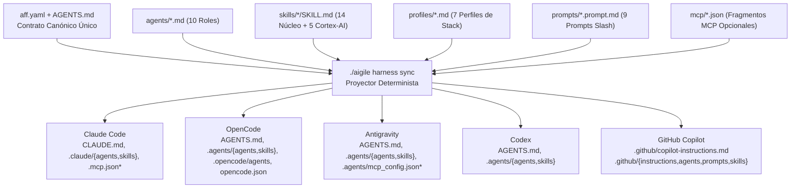

# aigile-forge-framework

> **Versión:** `1.1.2` | **Licencia:** [MIT](LICENSE) | **English documentation:** [`README.md`](README.md) | **Portal de documentación:** [`docs/es/index.md`](docs/es/index.md) | **Licencia:** [MIT (`LICENSE`)](LICENSE)

**`aigile-forge-framework`** es un marco universal y declarativo de ingeniería y gobierno asistido por IA para equipos de desarrollo de software. A partir de una única fuente canónica (`aff.yaml`, `AGENTS.md`, `agents/`, `skills/`, `profiles/`, `prompts/`, `templates/` y `mcp/`), `aigile-forge-framework` proyecta de forma determinista instrucciones operativas, agentes especializados por rol, habilidades procedimentales (`skills`), perfiles tecnológicos y descriptores opcionales de MCP hacia **Claude Code**, **OpenCode**, **Google Antigravity**, **OpenAI Codex** y **GitHub Copilot**.

`aigile-forge-framework` se adapta a cualquier tamaño de equipo de desarrollo, pila tecnológica, topología de repositorios y herramienta de gestión de tickets sin acoplar el código fuente a ningún proveedor, dominio regulatorio u organización específica.

---

## Inicio Rápido

### 1. Inicialización Interactiva

Ejecute el asistente unificado desde la raíz del repositorio para configurar un espacio de trabajo nuevo o existente:

```bash
./aigile init --lang es
```

### 2. Inicialización No Interactiva (CI / Automatización)

Genere un espacio de trabajo `multi-root` o basado en `worktrees` mediante banderas explícitas:

```bash
# Espacio de trabajo declarativo Zero-MCP en topología multi-root
./aigile init \
  --name plataforma-pagos \
  --team "Equipo de Plataforma" \
  --lang es \
  --topology multi-root \
  --mode zero-mcp \
  --harnesses all \
  --tracker jira \
  --prefix PAG \
  --workspace ~/workspaces/plataforma-pagos \
  --non-interactive

# Espacio de trabajo conectado con MCP y Git worktrees
./aigile init \
  --name api-central \
  --team "Equipo Backend Core" \
  --lang es \
  --topology worktrees \
  --mode mcp \
  --tracker github \
  --prefix API \
  --workspace ~/workspaces/api-central \
  --non-interactive
```

### 3. Verificación de Salud del Entorno

```bash
./aigile doctor
./aigile harness check
./aigile scan --install-hook
```

---

## Arquitectura General



*\*Los descriptores MCP (`.mcp.json`, `.agents/mcp_config.json` y el bloque `"mcp"` poblado en `opencode.json`) solo se emiten cuando `harnesses.mode: "mcp"`.*

---

## Matriz Universal de Harnesses

| Harness | Contrato Raíz | Agentes Especializados | Habilidades (`Skills`) | Perfiles Tecnológicos | Configuración MCP (modo `mcp`) |
|---|---|---|---|---|---|
| **Claude Code** | `CLAUDE.md` (`@AGENTS.md`) | `.claude/agents/*.md` | `.claude/skills/` | Vía `AGENTS.md` + `profiles/` | `.mcp.json` |
| **OpenCode** | `AGENTS.md` | `.agents/agents/*.md` y `.opencode/agents/*.md` | `.agents/skills/` | Vía `AGENTS.md` + `profiles/` | `opencode.json` (`"mcp"`) |
| **Antigravity** | `AGENTS.md` | `.agents/agents/*.md` | `.agents/skills/` | Vía `AGENTS.md` + `profiles/` | `.agents/mcp_config.json` |
| **Codex** | `AGENTS.md` | `.agents/agents/*.md` | `.agents/skills/` | Vía `AGENTS.md` + `profiles/` | `AGENTS.md` nativo + CLI local |
| **GitHub Copilot** | `.github/copilot-instructions.md` | `.github/agents/aff-*.agent.md` | `.github/skills/` | `.github/instructions/*.instructions.md` (`applyTo`) | 100% declarativo (`.github/prompts/*.prompt.md`) |

---

## Modos de Operación: Zero-MCP vs Full-MCP

`aigile-forge-framework` ofrece dos modos operativos controlados mediante `harnesses.mode` en `aff.yaml` o la opción `--mode` de la CLI:

| Característica | Modo `zero-mcp` (Predeterminado) | Modo `mcp` (Conectado / Cortex-AI) |
|---|---|---|
| **Demonios o binarios externos** | Ninguno (100% basado en archivos locales) | Servidores MCP parametrizados por `stdio` |
| **Entornos restringidos / VDI corporativo** | Compatible de inmediato | Requiere binarios y credenciales MCP autorizadas |
| **`.mcp.json` y `.agents/mcp_config.json`** | Omitidos o eliminados automáticamente | Generados desde `mcp/*.json` |
| **`opencode.json`** | `"mcp": {}` vacío | Mapa `"mcp"` poblado |
| **Sincronización de conocimiento** | `local` o `folder-sync` (`./aigile sync`) | Habilidades `cortex-ai-*` (Engram, CodeGraph, Google Drive, NotebookLM) |

Puede alternar entre modos en cualquier momento ejecutando:

```bash
./aigile harness sync all --mode zero-mcp
./aigile harness sync all --mode mcp
```

---

## Ciclo de Vida de 8 Fases y Compuertas Proporcionales (`G1`–`G4`)

Cada requerimiento se clasifica proporcionalmente (`S`, `M`, `L`, `H`) a lo largo de 8 fases (Fases 0 a 7) gobernadas por cuatro compuertas humanas (`G1`–`G4`) y evidencia criptográfica **Receipt-Driven Development (RDD)**:

| Fase | Nombre | Agente Principal | Artefactos Clave | Compuerta (`Gate`) |
|---|---|---|---|---|
| **0** | Incorporación del Equipo y Espacio de Trabajo | `onboarding` | `aff.yaml`, `knowledge/*.md` | Salud inicial con `./aigile doctor` |
| **1** | Recepción, Triaje y Aislamiento (`S/M/L/H`) | `orchestrator` | `work/<ID>/ticket-in.md`, `state.yaml`, `worktrees/<ID>/` | Clasificación proporcional asignada |
| **2** | Elicitación de Hipótesis y Estimación PERT | `pm` | `work/<ID>/elicitation.md` (incluye PERT) | Respuestas o valores por defecto confirmados |
| **3** | Hidratación de Especificación y Cortes | `analyst` | `work/<ID>/spec.md`, `slices/*.md` | **`G1`** — Definición de Listo (`G1a`/`G1b` opcional) |
| **4** | Diseño Guiado por Contratos y Paridad | `architect`, `security` | `work/<ID>/contract.md` | **`G2`** — Aprobación de Contrato y Paridad Multicanal |
| **5** | Unidades de Trabajo Atómicas y TDD | `delivery` | `odd/tasks/<id>-<slug>.md`, código + pruebas | Unidades `<= 400` líneas en verde |
| **6** | Auditoría 4R en Sesión Limpia y Refutación | `reviewer`, `qa` | `work/<ID>/review-4r.md`, `pr.md`, recibo `G3` | **`G3`** — Cero hallazgos `CRITICAL`/`HIGH` abiertos |
| **7** | Verificación de Entrega, Recibo RDD y Curaduría | `qa`, `curator`, `orchestrator` | `work/<ID>/evidence/receipt-G4.json`, `knowledge/`, `ticket-out.md` | **`G4`** — Firma SHA256 y cierre documental |

---

## Perfiles de Pila Tecnológica (`profiles/`)

Active o desactive los perfiles requeridos por su proyecto en la sección `profiles.enabled` de `aff.yaml`:

1. **`backend-jvm-spring`** — Java 8/17/21+, seguridad de nulos en Kotlin, Spring Boot 2.x/3.x/4.x, inyección por constructor y errores RFC 7807.
2. **`backend-node-ts`** — TypeScript estricto, manejo asíncrono acotado en Node.js, validación de esquemas en tiempo de ejecución y trazabilidad estructurada.
3. **`backend-python-go`** — Python tipado (`mypy`/`pyright`, FastAPI/Django) y Go idiomático (`context.Context`, envoltura explícita de errores).
4. **`frontend-web`** — Aplicaciones web modernas (Angular/React/Vue/Next.js), accesibilidad WCAG AA, aislamiento de estado y consumo tipado de contratos.
5. **`mobile-native`** — Desarrollo nativo Android (Kotlin/Compose, Keystore) e iOS (Swift/SwiftUI, Keychain) con paridad opcional 1:1 frente a web.
6. **`data-sql-nosql-cache`** — Índices obligatorios en predicados, validación de planes de ejecución, migraciones reversibles y claves de caché con TTL finito.
7. **`cicd-containers`** — Contenedores multietapa sin usuario root, pipelines reproducibles, digests fijados y cero secretos en compilación.

---

## Referencia de Comandos CLI (`./aigile`)

| Comando | Descripción |
|---|---|
| `./aigile init [opciones]` | Inicializador interactivo o desatendido del espacio de trabajo (`--name`, `--team`, `--lang`, `--topology`, `--mode`, `--harnesses`, `--tracker`, `--prefix`, `--workspace`, `--zero-footprint`, `--copy`, `--symlink`, `--non-interactive`). |
| `./aigile harness <sync\|check\|status\|print\|clean>` | Proyecta la fuente canónica hacia los harnesses, valida esquemas, consulta el estado o limpia archivos generados. |
| `./aigile doctor` | Verifica sistema operativo, `bash`, `git`, `python3`/`jq`, `aff.yaml`, modo activo y estado del hook `pre-commit`. |
| `./aigile worktree <create\|list\|checkpoint\|remove>` | Gestiona árboles de trabajo Git aislados por ticket bajo `worktrees/<ticket-id>/`. |
| `./aigile receipt <generate\|verify\|list>` | Genera recibos JSON sellados con SHA256 (`generate <id> <gate> -- <cmd...>`) y verifica su autenticidad (`verify <archivo> [--verify-head]`). |
| `./aigile session <start\|checkpoint\|close\|resume\|status\|list>` | Administra bitácoras estructuradas de sesión en Markdown bajo `work/sessions/`. |
| `./aigile scan [--path <ruta>\|--staged\|--install-hook]` | Inspecciona cambios preparados en Git o rutas en busca de claves privadas, tokens de API, secretos fijos y números PAN de 16 dígitos. |
| `./aigile sync [--status\|--sync [--dest <dir>]]` | Consulta o sincroniza `knowledge/` en modos `local`, `folder-sync` o `cortex-ai`. |

---

## Suite de Manuales y Guías (`docs/es/`)

La documentación operativa en español está estructurada en 10 manuales técnicos diseñados para consulta directa por rol:

| # | Manual / Guía | Audiencia Principal | Descripción |
|---|---|---|---|
| 1 | **[Portal de Documentación (`docs/es/index.md`)](docs/es/index.md)** | Todos los roles | Índice general, rutas de lectura recomendadas por perfil y mapa de navegación bilingüe. |
| 2 | **[Arquitectura Universal (`docs/es/architecture/overview.md`)](docs/es/architecture/overview.md)** | Arquitectos, Tech Leads | Separación en 3 capas, proyector determinista, modos `zero-mcp` vs `mcp`, `--zero-footprint` y criptografía RDD. |
| 3 | **[Instalación y Configuración (`docs/es/guides/installation-and-configuration.md`)](docs/es/guides/installation-and-configuration.md)** | Tech Leads, DevOps, Desarrolladores | Prerrequisitos por SO, modos de instalación, referencia campo por campo de `aff.yaml` v1.0, variables de entorno y diagnóstico. |
| 4 | **[Incorporación de Equipos y Topologías (`docs/es/guides/onboarding-and-topologies.md`)](docs/es/guides/onboarding-and-topologies.md)** | Tech Leads, Scrum Masters, PM | Asistente `./aigile init`, entrevista `/init-team` de 6 dimensiones, topologías de repositorio, tickets y estimación PERT. |
| 5 | **[Manual Operativo del Desarrollador (`docs/es/guides/developer-workflow-manual.md`)](docs/es/guides/developer-workflow-manual.md)** | Desarrolladores | Uso práctico en los 5 harnesses y 4 playbooks paso a paso: funcionalidad completa, interrupción sin `git stash`, hotfix `H` y paridad `L`. |
| 6 | **[Ciclo de Vida de 8 Fases, Compuertas y 4R (`docs/es/guides/lifecycle-gates-and-4r.md`)](docs/es/guides/lifecycle-gates-and-4r.md)** | QA, Revisores, Tech Leads | Detalle de Fases 0–7, matriz `S/M/L/H`, checklists de `G1`–`G4`, protocolo 4R de dos pasadas y anatomía de recibos SHA256. |
| 7 | **[Matriz de Compatibilidad Multi-Harness (`docs/es/harnesses/compatibility-matrix.md`)](docs/es/harnesses/compatibility-matrix.md)** | Todos los roles | Rutas proyectadas, transformaciones de encabezados YAML, esquemas JSON de MCP, `--symlink` vs `--copy` y limpieza. |
| 8 | **[Catálogo de Agentes y Slash Prompts (`docs/es/catalog/agents-and-prompts.md`)](docs/es/catalog/agents-and-prompts.md)** | Desarrolladores, Analistas, PM | Especificación de los 10 agentes principales, los 7 sub-roles de `delivery` y los 9 comandos slash con sus cadenas de entrega. |
| 9 | **[Catálogo de Habilidades y Perfiles de Stack (`docs/es/catalog/skills-and-profiles.md`)](docs/es/catalog/skills-and-profiles.md)** | Desarrolladores, Arquitectos | Las 14 `skills` de núcleo, las 5 `skills` opcionales `cortex-ai-*`, los 7 perfiles `profiles/*.md` y guía de extensión propia. |
| 10 | **[Seguridad, Datos y Sincronización de Conocimiento (`docs/es/governance/security-and-knowledge-sync.md`)](docs/es/governance/security-and-knowledge-sync.md)** | Seguridad, DBA, Curadores | Reglas de `aff-secret-scan.sh`, protección PII/PHI/PCI, índices y TTL en caché, y operación `local`, `folder-sync` y `cortex-ai`. |

---

## Licencia

Distribuido bajo la **Licencia MIT**. Consulte el archivo [`LICENSE`](LICENSE) en la raíz del repositorio para conocer los términos completos de uso, copia, modificación y distribución.
