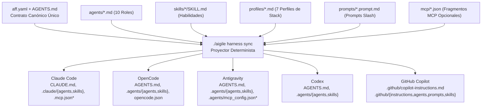

# aigile-forge-framework

> **English documentation:** [`README.md`](README.md) | **Portal de documentación:** [`docs/es/index.md`](docs/es/index.md)

**`aigile-forge-framework`** es un marco universal y declarativo de ingeniería y gobierno asistido por IA para equipos de desarrollo de software. A partir de una única fuente canónica (`aff.yaml`, `AGENTS.md`, `agents/`, `skills/`, `profiles/`, `prompts/`, `templates/` y `mcp/`), aigile-forge-framework proyecta de forma determinista instrucciones, agentes por rol, habilidades procedimentales (`skills`), perfiles tecnológicos y descriptores opcionales de MCP hacia **Claude Code**, **OpenCode**, **Google Antigravity**, **OpenAI Codex** y **GitHub Copilot**.

aigile-forge-framework se adapta a cualquier tamaño de equipo, pila tecnológica, topología de repositorios y herramienta de seguimiento de tickets sin acoplar el código fuente a ningún proveedor u organización específica.

---

## Inicio Rápido

### 1. Inicialización Interactiva

Ejecute el asistente unificado desde la raíz del repositorio para configurar un espacio de trabajo nuevo o existente:

```bash
./aigile init --lang es
```

### 2. Inicialización No Interactiva (CI / Automatización)

 Genere un espacio de trabajo `multi-root` o basado en `worktrees` mediante banderas explícitas:

```bash
# Espacio de trabajo declarativo Zero-MCP en topología multi-root
./aigile init \
  --name plataforma-pagos \
  --team "Equipo de Plataforma" \
  --lang es \
  --topology multi-root \
  --mode zero-mcp \
  --harnesses all \
  --tracker jira \
  --prefix PAG \
  --workspace ~/workspaces/plataforma-pagos \
  --non-interactive

# Espacio de trabajo conectado con MCP y Git worktrees
./aigile init \
  --name api-central \
  --team "Equipo Backend Core" \
  --lang es \
  --topology worktrees \
  --mode mcp \
  --tracker github \
  --prefix API \
  --workspace ~/workspaces/api-central \
  --non-interactive
```

### 3. Verificación de Salud del Entorno

```bash
./aigile doctor
./aigile harness check
./aigile scan --install-hook
```

---

## Arquitectura General



*\*Los descriptores MCP (`.mcp.json`, `.agents/mcp_config.json` y el bloque `"mcp"` poblado en `opencode.json`) solo se emiten cuando `harnesses.mode: "mcp"`.*

---

## Matriz Universal de Harnesses

| Harness | Contrato Raíz | Agentes Especializados | Habilidades (`Skills`) | Perfiles Tecnológicos | Configuración MCP (modo `mcp`) |
|---|---|---|---|---|---|
| **Claude Code** | `CLAUDE.md` (`@AGENTS.md`) | `.claude/agents/*.md` | `.claude/skills/` | Vía `AGENTS.md` + `profiles/` | `.mcp.json` |
| **OpenCode** | `AGENTS.md` | `.agents/agents/*.md` y `.opencode/agents/*.md` | `.agents/skills/` | Vía `AGENTS.md` + `profiles/` | `opencode.json` (`"mcp"`) |
| **Antigravity** | `AGENTS.md` | `.agents/agents/*.md` | `.agents/skills/` | Vía `AGENTS.md` + `profiles/` | `.agents/mcp_config.json` |
| **Codex** | `AGENTS.md` | `.agents/agents/*.md` | `.agents/skills/` | Vía `AGENTS.md` + `profiles/` | `AGENTS.md` nativo + CLI local |
| **GitHub Copilot** | `.github/copilot-instructions.md` | `.github/agents/aff-*.agent.md` | `.github/skills/` | `.github/instructions/*.instructions.md` (`applyTo`) | 100% declarativo (`.github/prompts/*.prompt.md`) |

---

## Modos de Operación: Zero-MCP vs Full-MCP

aigile-forge-framework ofrece dos modos controlados mediante `harnesses.mode` en `aff.yaml` o la opción `--mode` de la CLI:

| Característica | Modo `zero-mcp` (Predeterminado) | Modo `mcp` (Conectado / Cortex-AI) |
|---|---|---|
| **Demonios o binarios externos** | Ninguno (100% basado en archivos locales) | Servidores MCP parametrizados por `stdio` |
| **Entornos restringidos / VDI corporativo** | Compatible de inmediato | Requiere binarios y credenciales MCP autorizadas |
| **`.mcp.json` y `.agents/mcp_config.json`** | Omitidos o eliminados automáticamente | Generados desde `mcp/*.json` |
| **`opencode.json`** | `"mcp": {}` vacío | Mapa `"mcp"` poblado |
| **Sincronización de conocimiento** | `local` o `folder-sync` (`./aigile sync`) | Habilidades `cortex-ai-*` (Engram, CodeGraph, Drive, NotebookLM) |

Puede alternar entre modos en cualquier momento ejecutando:

```bash
./aigile harness sync all --mode zero-mcp
./aigile harness sync all --mode mcp
```

---

## Ciclo de Vida de 8 Fases y Compuertas Proporcionales (`G1`–`G4`)

Cada requerimiento se clasifica proporcionalmente (`S`, `M`, `L`, `H`) a lo largo de 8 fases gobernadas por cuatro compuertas humanas (`G1`–`G4`) y evidencia criptográfica **Receipt-Driven Development (RDD)**:

| Fase | Nombre | Agente Principal | Artefactos Clave | Compuerta (`Gate`) |
|---|---|---|---|---|
| **0** | Recepción y Triaje (`S/M/L/H`) | `orchestrator` | `work/<ID>/ticket-in.md`, `state.yaml` | — |
| **1** | Descubrimiento y Especificación | `pm` / `analyst` | `elicitation.md`, `spec.md`, estimación PERT | **`G1`** — Alcance y Definición de Listo (`G1a`/`G1b` opcional) |
| **2** | Arquitectura y Contratos Primero | `architect` | `contract.md`, especificaciones OpenAPI/AsyncAPI/Esquemas | **`G2`** — Aprobación de Contrato y Paridad Multicanal |
| **3** | Partición de Tareas y Aislamiento | `orchestrator` / `delivery` | `odd/tasks/*.md`, `worktrees/<ID>/` | — |
| **4** | Implementación Guiada por Pruebas | `delivery` | Código productivo + pruebas automatizadas | — |
| **5** | Revisión Adversarial 4R y Seguridad | `reviewer` / `security` / `qa` | `review-4r.md` (**Risk, Requirements, Regression, Resilience**) | **`G3`** — Aprobación 4R en Sesión Limpia y Seguridad |
| **6** | Verificación de Entrega y Recibos | `qa` / `delivery` | `work/<ID>/evidence/receipt-G4.json` | **`G4`** — Preparación de Despliegue y Firma SHA256 |
| **7** | Curaduría de Conocimiento y Cierre | `curator` / `orchestrator` | `knowledge/*.md`, `ticket-out.md`, cierre de sesión | — |

---

## Perfiles de Pila Tecnológica (`profiles/`)

Active o desactive los perfiles requeridos por su proyecto en la sección `profiles.enabled` de `aff.yaml`:

1. **`backend-jvm-spring`** — Java 17/21, seguridad de nulos en Kotlin, Spring Boot, inyección por constructor y errores RFC 7807.
2. **`backend-node-ts`** — TypeScript estricto, manejo asíncrono seguro en Node.js, validación de esquemas y trazabilidad estructurada.
3. **`backend-python-go`** — Python tipado (`mypy`/`ruff`) y Go idiomático (`context.Context`, manejo explícito de errores).
4. **`frontend-web`** — Aplicaciones web modernas (Angular/React/Vue), accesibilidad WCAG, aislamiento de estado y control de paquetes.
5. **`mobile-native`** — Desarrollo nativo Android (Kotlin/Compose) e iOS (Swift/SwiftUI) con paridad opcional 1:1 frente a web.
6. **`data-sql-nosql-cache`** — Índices obligatorios, validación de planes de ejecución, migraciones seguras, patrones NoSQL y TTL explícito en caché.
7. **`cicd-containers`** — Contenedores multietapa sin usuario root, pipelines reproducibles, registros libres de secretos y reversión segura.

---

## Referencia de Comandos CLI (`./aigile`)

| Comando | Descripción |
|---|---|
| `./aigile init [opciones]` | Inicializador interactivo o desatendido del espacio de trabajo (`--name`, `--team`, `--lang`, `--topology`, `--mode`, `--harnesses`, `--tracker`, `--prefix`, `--workspace`, `--non-interactive`). |
| `./aigile harness <sync\|check\|status\|print\|clean>` | Proyecta la fuente canónica a los harnesses, valida esquemas, consulta el estado o limpia archivos generados. |
| `./aigile doctor` | Verifica sistema operativo, `bash`, `git`, `python3`/`jq`, `aff.yaml`, modo activo y estado del hook `pre-commit`. |
| `./aigile worktree <create\|list\|checkpoint\|remove>` | Gestiona árboles de trabajo Git aislados por ticket bajo `worktrees/<ticket-id>/`. |
| `./aigile receipt <generate\|verify\|list>` | Genera recibos JSON sellados con SHA256 (`generate <id> <gate> -- <cmd...>`) y verifica su autenticidad (`verify <archivo> [--verify-head]`). |
| `./aigile session <start\|checkpoint\|close\|resume>` | Administra bitácoras estructuradas de sesión en Markdown bajo `work/sessions/`. |
| `./aigile scan [--path <ruta>\|--install-hook]` | Inspecciona cambios preparados en Git o rutas en busca de claves privadas, tokens de API, secretos fijos y números de tarjeta de 16 dígitos. |
| `./aigile sync [--status\|--sync [--dest <dir>]]` | Consulta o sincroniza `knowledge/` en modos `local`, `folder-sync` o `cortex-ai`. |

---

## Portal de Documentación

- [Índice de Documentación (`docs/es/index.md`)](docs/es/index.md)
- [Arquitectura y Proyector Universal (`docs/es/architecture/overview.md`)](docs/es/architecture/overview.md)
- [Incorporación de Equipos y Topologías de Espacio de Trabajo (`docs/es/guides/onboarding-and-topologies.md`)](docs/es/guides/onboarding-and-topologies.md)
- [Ciclo de Vida de 8 Fases, Compuertas G1–G4, Revisión 4R y Recibos RDD (`docs/es/guides/lifecycle-gates-and-4r.md`)](docs/es/guides/lifecycle-gates-and-4r.md)
