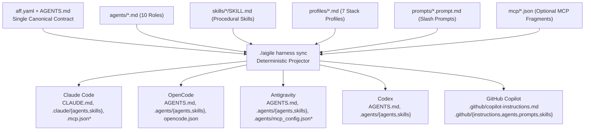

# aigile-forge-framework

> **Version:** `1.1.0` | **License:** [MIT](LICENSE) | **Spanish documentation:** [`README.es.md`](README.es.md) | **Documentation Portal:** [`docs/en/index.md`](docs/en/index.md) | **License:** [MIT](LICENSE)

**`aigile-forge-framework`** is an open-source, universal, declarative engineering harness and governance framework for software development teams. From a single canonical source (`aff.yaml`, `AGENTS.md`, `agents/`, `skills/`, `profiles/`, `prompts/`, `templates/`, and `mcp/`), `aigile-forge-framework` deterministically projects instructions, specialist role agents, procedural skills, stack guardrails, and optional MCP descriptors across **Claude Code**, **OpenCode**, **Google Antigravity**, **OpenAI Codex**, and **GitHub Copilot**.

`aigile-forge-framework` adapts to any team size, technology stack, repository topology, and issue tracker without coupling your codebase to a specific AI vendor or organization.

---

## Quickstart

### 1. Interactive Initialization

Run the unified CLI wizard from the repository root to initialize a new or existing project workspace:

```bash
./aigile init
```

### 2. Non-Interactive Scaffolding

Provision a multi-root or worktree-based workspace in CI or automated scripts:

```bash
# Declarative Zero-MCP multi-root workspace
./aigile init \
  --name billing-platform \
  --team "Platform Engineering" \
  --lang en \
  --topology multi-root \
  --mode zero-mcp \
  --harnesses all \
  --tracker linear \
  --prefix BILL \
  --workspace ~/workspaces/billing-platform \
  --non-interactive

# Connected MCP + Git worktree workspace
./aigile init \
  --name core-api \
  --team "Core API Team" \
  --topology worktrees \
  --mode mcp \
  --tracker github \
  --prefix API \
  --workspace ~/workspaces/core-api \
  --non-interactive
```

### 3. Verify Baseline Health

```bash
./aigile doctor
./aigile harness check
./aigile scan --install-hook
```

---

## Architecture Overview



*\*MCP configuration files (`.mcp.json`, `.agents/mcp_config.json`, populated `opencode.json`) are emitted exclusively when `harnesses.mode: "mcp"`.*

---

## Universal Harness Matrix

| Harness | Root Contract | Specialist Agents | Procedural Skills | Scoped Stack Profiles | MCP Configuration (`mcp` mode) |
|---|---|---|---|---|---|
| **Claude Code** | `CLAUDE.md` (`@AGENTS.md`) | `.claude/agents/*.md` | `.claude/skills/` | Loaded via `AGENTS.md` + `profiles/` | `.mcp.json` |
| **OpenCode** | `AGENTS.md` | `.agents/agents/*.md` & `.opencode/agents/*.md` | `.agents/skills/` | Loaded via `AGENTS.md` + `profiles/` | `opencode.json` (`"mcp"`) |
| **Antigravity** | `AGENTS.md` | `.agents/agents/*.md` | `.agents/skills/` | Loaded via `AGENTS.md` + `profiles/` | `.agents/mcp_config.json` |
| **Codex** | `AGENTS.md` | `.agents/agents/*.md` | `.agents/skills/` | Loaded via `AGENTS.md` + `profiles/` | Native `AGENTS.md` + local CLI |
| **GitHub Copilot** | `.github/copilot-instructions.md` | `.github/agents/aff-*.agent.md` | `.github/skills/` | `.github/instructions/*.instructions.md` (`applyTo`) | Pure declarative (`.github/prompts/*.prompt.md`) |

---

## Zero-MCP vs Full-MCP Modes

`aigile-forge-framework` supports two operational modes controlled by `harnesses.mode` in `aff.yaml` or `--mode` on the CLI:

| Capability | `zero-mcp` Mode (Default) | `mcp` Mode (Connected / Cortex-AI) |
|---|---|---|
| **External Daemons / Binaries** | None required (100% file-based) | Parameterized stdio MCP servers |
| **Enterprise Firewall / Restricted VDI** | Works out of the box | Requires approved MCP binaries/tokens |
| **Claude `.mcp.json` / Antigravity `mcp_config.json`** | Omitted / removed cleanly | Generated from `mcp/*.json` |
| **OpenCode `opencode.json`** | `"mcp": {}` | Populated `"mcp"` server map |
| **Knowledge Synchronization** | `local` or `folder-sync` (`./aigile sync`) | `cortex-ai` skills (Engram, CodeGraph, Drive, NotebookLM) |

Switch modes at any time and re-project deterministically:

```bash
./aigile harness sync all --mode zero-mcp
./aigile harness sync all --mode mcp
```

---

## 8-Phase Engineering Lifecycle & Proportional Gates (`G1`–`G4`)

Work items are triaged proportionally (`S`, `M`, `L`, `H`) across an 8-phase lifecycle governed by four human verification gates and cryptographic **Receipt-Driven Development (RDD)** evidence:

| Phase | Name | Primary Role Agent | Key Artifact(s) | Gate |
|---|---|---|---|---|
| **0** | Team & Workspace Onboarding | `onboarding` | `aff.yaml`, `knowledge/*.md` | `./aigile doctor` baseline |
| **1** | Intake, Triage & Isolation | `orchestrator` | `work/<ID>/ticket-in.md`, `state.yaml`, worktree | Size (`S/M/L/H`) assigned |
| **2** | Hypothesis Elicitation & PERT | `pm` | `work/<ID>/elicitation.md` | Stakeholder answers collected |
| **3** | Functional Spec Hydration & Slices | `analyst` | `work/<ID>/spec.md`, `slices/*.md` | **`G1`** — Scope & DoR Sign-Off (`G1a`/`G1b` optional) |
| **4** | Contract-First & Channel Parity | `architect` / `security` | `work/<ID>/contract.md` | **`G2`** — Contract & Security/Parity Sign-Off |
| **5** | Work-Unit Planning & TDD Execution | `delivery` | `odd/tasks/*.md`, code + unit/integration tests | Every unit `<= 400` LoC |
| **6** | Clean-Session 4R & Refuter Audit | `reviewer` / `qa` | `work/<ID>/review-4r.md`, `pr.md`, `receipt-G3.json` | **`G3`** — Clean-Session 4R & PR Approval |
| **7** | Release Verification & Curation | `qa` / `curator` / `orchestrator` | `work/<ID>/evidence/receipt-G4.json`, `ticket-out.md` | **`G4`** — Release Readiness & Knowledge Sync |

---

## Pluggable Stack Profiles (`profiles/`)

Enable or disable technology guardrails in `aff.yaml` under `profiles.enabled`:

1. **`backend-jvm-spring`** — Java 8/17/21+, Kotlin null-safety, Spring Boot 2.x/3.x, constructor injection, RFC 7807 error contracts.
2. **`backend-node-ts`** — Strict TypeScript, Node.js async boundaries, schema validation, structured logging.
3. **`backend-python-go`** — Typed Python (`mypy`/`ruff`/`pytest`) and idiomatic Go (`context.Context`, explicit error wrapping).
4. **`frontend-web`** — Modern Angular/React/Vue/Next.js standards, WCAG AA accessibility, state isolation, zero client domain drift.
5. **`mobile-native`** — Kotlin/Jetpack Compose (Android) & Swift/SwiftUI (iOS) with secure storage and optional 1:1 parity.
6. **`data-sql-nosql-cache`** — Relational indexing, execution-plan validation, reversible migrations, NoSQL patterns, and finite cache TTLs.
7. **`cicd-containers`** — Multi-stage non-root container builds, pinned pipelines, secret-free build logs, and rollback safety.

---

## CLI Reference (`./aigile`)

| Command | Description |
|---|---|
| `./aigile init [options]` | Interactive or non-interactive workspace bootstrapper (`--name`, `--team`, `--lang`, `--topology`, `--mode`, `--harnesses`, `--tracker`, `--prefix`, `--workspace`, `--zero-footprint`, `--copy`, `--symlink`, `--non-interactive`). |
| `./aigile harness <sync\|check\|status\|print\|clean>` | Project canonical sources to target harnesses, validate schemas, inspect status, print JSON summaries, or clean projections. |
| `./aigile doctor` | Verify OS, `bash`, `git`, `python3`/`jq`, `aff.yaml`, harness mode, and git pre-commit hook status. |
| `./aigile worktree <create\|list\|checkpoint\|remove>` | Manage ticket-isolated git worktrees under `worktrees/<ticket-id>/`. |
| `./aigile receipt <generate\|verify\|list>` | Generate SHA256-sealed JSON execution receipts (`generate <id> <gate> -- <cmd...>`) and verify integrity (`verify <file> [--verify-head]`). |
| `./aigile session <start\|checkpoint\|close\|resume\|status\|list>` | Maintain structured Markdown session journals under `work/sessions/`. |
| `./aigile scan [--path <p>\|--staged\|--install-hook]` | Scan staged git diffs or paths for private keys, cloud/API tokens, hardcoded secrets, and raw 16-digit card numbers. |
| `./aigile sync [--status\|--sync [--dest <dir>]]` | Inspect or synchronize `knowledge/` via `local`, `folder-sync`, or `cortex-ai` modes. |

---

## Documentation & Manuals Suite (`docs/en/`)

`aigile-forge-framework` ships with a complete 10-document operational manual suite in English (mirrored 1:1 in Spanish under [`docs/es/index.md`](docs/es/index.md)):

| # | Manual | Audience | Path |
|---|---|---|---|
| 1 | **Documentation Portal & Role Learning Paths** | All Roles | [`docs/en/index.md`](docs/en/index.md) |
| 2 | **Universal Architecture & Projector Deep Dive** | Architects, Tech Leads | [`docs/en/architecture/overview.md`](docs/en/architecture/overview.md) |
| 3 | **Installation & `aff.yaml` v1.0 Configuration Manual** | Tech Leads, DevOps, Developers | [`docs/en/guides/installation-and-configuration.md`](docs/en/guides/installation-and-configuration.md) |
| 4 | **Team Onboarding, Topologies & PERT Estimation** | Tech Leads, PMs, Scrum Masters | [`docs/en/guides/onboarding-and-topologies.md`](docs/en/guides/onboarding-and-topologies.md) |
| 5 | **Day-to-Day Developer Operational Manual** | Software Engineers | [`docs/en/guides/developer-workflow-manual.md`](docs/en/guides/developer-workflow-manual.md) |
| 6 | **8-Phase Lifecycle, Gates `G1`–`G4`, 4R & RDD Receipts** | QA, Reviewers, Tech Leads | [`docs/en/guides/lifecycle-gates-and-4r.md`](docs/en/guides/lifecycle-gates-and-4r.md) |
| 7 | **Multi-Harness Compatibility & Projection Matrix** | Platform Engineers, Tooling Owners | [`docs/en/harnesses/compatibility-matrix.md`](docs/en/harnesses/compatibility-matrix.md) |
| 8 | **Agents, Delivery Sub-Roles & Slash Prompts Catalog** | All Engineers & Agents | [`docs/en/catalog/agents-and-prompts.md`](docs/en/catalog/agents-and-prompts.md) |
| 9 | **Procedural Skills & Pluggable Stack Profiles Catalog** | Engineers, Architects | [`docs/en/catalog/skills-and-profiles.md`](docs/en/catalog/skills-and-profiles.md) |
| 10 | **Security Guardrails, Data Governance & Knowledge Sync** | Security, Curators, DevOps | [`docs/en/governance/security-and-knowledge-sync.md`](docs/en/governance/security-and-knowledge-sync.md) |

---

## License

`aigile-forge-framework` is open-source software released under the [MIT License](LICENSE) (`Copyright (c) 2026 aigile-forge-framework Contributors`).
