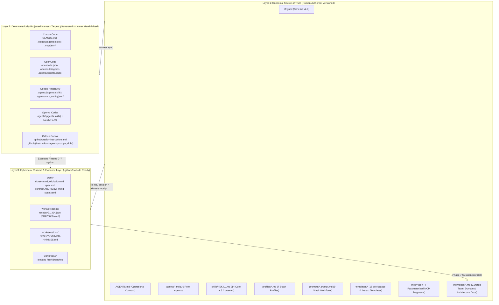
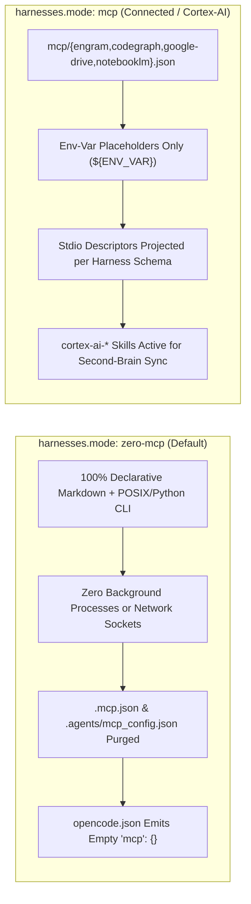

# Universal Architecture & Deterministic Projection

> **Back to Portal:** [`docs/en/index.md`](../index.md) | **Español:** [`docs/es/architecture/overview.md`](../../es/architecture/overview.md)  
> **Related Manuals:** [Harness Compatibility Matrix](../harnesses/compatibility-matrix.md) · [Installation & Configuration](../guides/installation-and-configuration.md) · [Lifecycle & RDD Receipts](../guides/lifecycle-gates-and-4r.md)

`aigile-forge-framework` solves a pervasive failure mode in AI-assisted software engineering: **configuration fragmentation and governance drift**. When different engineers on the same team use Claude Code, OpenCode, Google Antigravity, OpenAI Codex, or GitHub Copilot, teams often duplicate instructions across `.github/`, `.claude/`, `.agents/`, and ad-hoc prompt files that diverge within days.

`aigile-forge-framework` establishes a strict **three-layer architecture** backed by a deterministic POSIX/Python projector (`scripts/aff-harness.sh`) and cryptographic execution receipts (`scripts/aff-receipt.sh`).

---

## 1. Three-Layer Architectural Separation

Every `aigile-forge-framework` workspace cleanly separates **what the team governs**, **what AI harnesses consume**, and **what in-flight tickets produce**:



### Canonical Directory Layout

```text
aigile-forge-framework/
├── aigile                     # Unified cross-platform CLI dispatcher (Linux, macOS, WSL, Git-Bash)
├── aff.yaml                   # Canonical project, team, topology, governance & guardrail manifest
├── AGENTS.md                  # Universal AI operational contract & catalog index
├── LICENSE                    # MIT open-source license
├── agents/                    # 10 harness-neutral specialist role definitions (*.md)
├── skills/                    # 14 core + 5 optional cortex-ai-* procedural skills (*/SKILL.md)
├── profiles/                  # 7 pluggable technology stack guardrail profiles (*.md)
├── prompts/                   # 9 reusable slash-command prompt workflows (*.prompt.md)
├── templates/                 # 16 parameterized Markdown, YAML, and JSON templates
├── mcp/                       # 4 parameterized stdio MCP server fragments (*.json)
├── configs/                   # Canonical projector capability matrix (harnesses.json)
├── scripts/                   # Deterministic operational engines (aff-*.sh)
├── knowledge/                 # Curated team roster, domain overview, architecture map & ADRs
├── odd/tasks/                 # Living Organic Driven Development task slices (<ticket>-<slug>.md)
├── work/                      # Per-ticket lifecycle artifacts, sessions/ & SHA256 evidence/
└── worktrees/                 # Ticket-isolated Git worktrees (when topology == worktrees)
```

> **Immutability Rule:** Engineers and agents NEVER hand-edit Layer 2 files (`CLAUDE.md`, `.claude/`, `.agents/`, `.opencode/`, `.github/`, `.mcp.json`, `opencode.json`). Modify Layer 1 canonical sources and run `./aigile harness sync`.

---

## 2. Deterministic Projection Data Flow

When you execute `./aigile harness sync [all|claude|opencode|antigravity|codex|copilot]`, `scripts/aff-harness.sh` performs an idempotent compilation pass:

1. **Manifest Resolution:** Parses `aff.yaml` (using `PyYAML` when installed, or a built-in zero-dependency pure-Python parser fallback) to determine `project`, `team`, `workspace.topology`, `harnesses.mode`, `harnesses.enabled`, and `profiles.enabled`.
2. **Frontmatter & Schema Normalization:**
   - Standard CLI agents (`.claude/agents/`, `.agents/agents/`, `.opencode/agents/`) receive normalized `name`, escaped `description`, and `mode: all` frontmatter.
   - GitHub Copilot custom agents (`.github/agents/aff-<slug>.agent.md`) receive `name: aff-<slug>`, `description`, and `tools: ['read', 'search', 'edit', 'execute']`.
   - Enabled stack profiles (`profiles/*.md`) compile into `.github/instructions/<slug>.instructions.md` with scoped `applyTo` file globs so Copilot injects stack rules only when matching files are open.
3. **Skill Linking or Copying:** Synchronizes `skills/` into `.claude/skills`, `.agents/skills`, and `.github/skills` via relative symlinks (`--symlink`, default on Linux/macOS/WSL in-place) or deep directory copies (`--copy`, automatic for external target workspaces and Windows Git-Bash/MSYS).
4. **Mode-Gated MCP Emission:** Merges `mcp/*.json` fragments into `.mcp.json`, `opencode.json`, and `.agents/mcp_config.json` **only** when `effective_mode == "mcp"`, actively deleting stale MCP files whenever `effective_mode == "zero-mcp"`.

---

## 3. Zero-MCP vs Full-MCP (`cortex-ai`) Architectural Design

Enterprise environments vary widely in security posture. `aigile-forge-framework` treats MCP connectivity as an opt-in capability rather than a hard dependency:



- **Why `zero-mcp` is the default:** Regulated financial, healthcare, public-sector, and air-gapped teams can adopt `aigile-forge-framework` immediately inside restricted VDIs or locked-down laptops without requesting firewall exceptions, OAuth tokens, or external binary approvals.
- **Why `mcp/*.json` uses `${ENV_VAR}` placeholders:** Even in `mcp` mode, canonical fragments (`mcp/engram.json`, `mcp/codegraph.json`, `mcp/google-drive.json`, `mcp/notebooklm.json`) store zero live folder IDs, notebook IDs, or credentials in Git. Values bind at runtime from developer environment variables.
- **Policy Enforcement:** Running `./aigile harness check` verifies that if `aff.yaml` specifies `harnesses.mode: "zero-mcp"`, the presence of `.mcp.json`, `.agents/mcp_config.json`, or a non-empty `"mcp"` object in `opencode.json` triggers an immediate non-zero validation failure.

---

## 4. Zero-Footprint Local Mechanics (`.git/info/exclude`)

Teams adopting `aigile-forge-framework` inside an existing repository often face two distinct rollout scenarios:

1. **Team-Wide Committed Governance:** `aff.yaml`, `AGENTS.md`, and projected harness files are committed to the repository, while ephemeral ticket directories (`work/` and `worktrees/`) remain local.
2. **Individual / Zero-Footprint Adoption (`--zero-footprint`):** An engineer wants full `aigile-forge-framework` capabilities inside a shared legacy repository without modifying `.gitignore` or polluting `git status` for teammates who have not onboarded yet.

`./aigile init` solves both cleanly via `configure_git_exclude` in `./aigile`, writing directly to **`.git/info/exclude`** (Git's native per-clone local exclude file, resolved dynamically via `git rev-parse --git-path info/exclude` so linked worktrees are also respected):

- **Always excluded locally:** `work/` and `worktrees/`.
- ** additionally excluded when `--zero-footprint` is passed:** `aff.yaml`, `CLAUDE.md`, `.claude/`, `.mcp.json`, `opencode.json`, `.agents/`, `.opencode/`, `.github/copilot-instructions.md`, `.github/instructions/`, `.github/agents/`, `.github/prompts/`, and `.github/skills/`.

Because `.git/info/exclude` is never staged or pushed, `git status` stays completely clean with zero changes to tracked repository files.

---

## 5. Deterministic SHA256 Receipt-Driven Development (RDD) Cryptography

AI agents can hallucinate passing test runs or claim gate readiness after modifying code post-test. `aigile-forge-framework` eliminates trust-by-assertion through `scripts/aff-receipt.sh` (`./aigile receipt`):

1. **Execution Capture:** `./aigile receipt generate <TICKET-ID> <GATE> -- <command...>` records the UTC timestamp (`timestamp_utc`), exact `git rev-parse HEAD` (`git_head`), the SHA256 digest of uncommitted working-tree changes (`working_tree_diff_sha256` from `git diff HEAD --no-ext-diff`), and executes `<command...>` while capturing combined stdout/stderr to compute `output_sha256` and `exit_code`.
2. **Canonical JSON Serialization:** All payload fields (excluding `receipt_sha256`) are serialized deterministically in Python using `json.dumps(payload, sort_keys=True, separators=(",", ":"), ensure_ascii=True)`.
3. **Tamper-Evident Sealing:** The SHA256 hex digest of that canonical byte stream is written into `receipt_sha256` inside `work/<TICKET-ID>/evidence/receipt-<GATE>.json`.
4. **Independent Verification:** `./aigile receipt verify <receipt-file> [--verify-head]` strips `receipt_sha256`, recomputes the canonical digest, fails immediately if a single character of `command`, `exit_code`, `git_head`, or `output_sha256` was altered, and—when `--verify-head` is passed—verifies that `git_head` still matches the repository's current `HEAD` commit.
