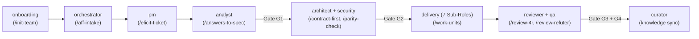

# Agents, Delivery Sub-Roles & Slash Prompts Catalog

> **Back to Portal:** [`docs/en/index.md`](../index.md) | **Español:** [`docs/es/catalog/agents-and-prompts.md`](../../es/catalog/agents-and-prompts.md)  
> **Related Manuals:** [Skills & Stack Profiles Catalog](skills-and-profiles.md) · [Developer Workflow Manual](../guides/developer-workflow-manual.md) · [Lifecycle & Gates](../guides/lifecycle-gates-and-4r.md)

This catalog provides the complete engineering specification for all **10 Core Specialist Agents** (`agents/*.md`), the **7 Specialized Delivery Sub-Roles** coordinated by `delivery`, and the **9 Slash Command Prompts** (`prompts/*.prompt.md`) included in **`aigile-forge-framework`**.

---

## 1. End-to-End Agent & Prompt Handoff Chain



---

## 2. Ten Core Specialist Agents (`agents/*.md`)

Every canonical file in `agents/<slug>.md` projects to `.claude/agents/<slug>.md`, `.agents/agents/<slug>.md`, `.opencode/agents/<slug>.md`, and `.github/agents/aff-<slug>.agent.md`.

### 2.1 `onboarding` — Team & Project Onboarding Architect
- **Canonical File:** `agents/onboarding.md` | **Copilot Agent:** `@aff-onboarding`
- **Recommended Tools:** `["read", "search", "edit", "terminal"]`
- **Primary Skills & Prompts:** `team-onboarding-bootstrap`, `/init-team`
- **Inputs:** Existing repository structure (if any), `templates/aff.template.yaml`, stakeholder responses across 6 discovery dimensions.
- **Outputs:** Configured `aff.yaml` (v1.0), `knowledge/{team-roster,domain-overview,architecture-map,team-workflow}.md`, optional `<project-id>.code-workspace`, and synced harnesses.

### 2.2 `orchestrator` — Lifecycle & Workspace Orchestrator
- **Canonical File:** `agents/orchestrator.md` | **Copilot Agent:** `@aff-orchestrator`
- **Recommended Tools:** `["read", "search", "edit", "terminal"]`
- **Primary Skills & Prompts:** `odd-workflow`, `knowledge-checkpoint-curation`, `/aff-intake`
- **Inputs:** Raw backlog issue, `aff.yaml`, `work/<TICKET-ID>/state.yaml`.
- **Outputs:** Sanitized `work/<TICKET-ID>/ticket-in.md`, proportional size triage (`S/M/L/H`), `state.yaml` gate SHA tracking, `./aigile worktree` isolation, and `ticket-out.md`.

### 2.3 `pm` — Product Manager & Estimation Lead
- **Canonical File:** `agents/pm.md` | **Copilot Agent:** `@aff-pm`
- **Recommended Tools:** `["read", "search", "edit"]`
- **Primary Skills & Prompts:** `bilingual-elicitation`, `/elicit-ticket`
- **Inputs:** `work/<TICKET-ID>/ticket-in.md`, `knowledge/domain-overview.md`, `aff.yaml` (`team.language`, `estimation`).
- **Outputs:** `work/<TICKET-ID>/elicitation.md` with explicit domain hypotheses, `<= 10` prioritized `P1`–`P3` clarification questions (each with a recommended default), and optional 3-point PERT calculation.

### 2.4 `analyst` — Functional & Systems Analyst
- **Canonical File:** `agents/analyst.md` | **Copilot Agent:** `@aff-analyst`
- **Recommended Tools:** `["read", "search", "edit"]`
- **Primary Skills & Prompts:** `spec-crafting-hydration`, `incident-rca-debugging`, `/answers-to-spec`
- **Inputs:** Answered `elicitation.md`, `knowledge/architecture-map.md`.
- **Outputs:** `work/<TICKET-ID>/spec.md` (`S#` items + deterministic Gherkin `Given/When/Then` `AC-#` criteria), cross-repository `work/<TICKET-ID>/slices/*.md`, and Gate `G1` (`G1a`/`G1b`) readiness checklist.

### 2.5 `architect` — Principal Software Architect
- **Canonical File:** `agents/architect.md` | **Copilot Agent:** `@aff-architect`
- **Recommended Tools:** `["read", "search", "edit"]`
- **Primary Skills & Prompts:** `contract-first-design`, `multi-channel-parity`, `db-cache-guardrails`, `/contract-first`, `/parity-check`
- **Inputs:** Approved `spec.md` (`G1`), `knowledge/architecture-map.md`, active `profiles/*.md`.
- **Outputs:** `work/<TICKET-ID>/contract.md` (OpenAPI 3.1 / AsyncAPI / GraphQL / Protobuf contracts, RFC 7807 error taxonomy, N/N-1 compatibility plan, indexed DB predicates, finite-TTL cache keys, synthetic mocks, and optional 1:1 Web/Android/iOS parity certification for Gate `G2`).

### 2.6 `security` — Application & Platform Security Auditor
- **Canonical File:** `agents/security.md` | **Copilot Agent:** `@aff-security`
- **Recommended Tools:** `["read", "search", "terminal"]`
- **Primary Skills:** `security-compliance-audit`, `db-cache-guardrails`
- **Inputs:** `contract.md`, source diffs, `aff.yaml` (`guardrails.redact_patterns`), `./aigile scan` output.
- **Outputs:** `work/<TICKET-ID>/security-review.md` verifying OWASP Top 10 controls, zero secret/PII/PCI/PHI leakage, query indexing, finite cache TTLs, rootless container hardening, and Android Keystore / iOS Keychain storage.

### 2.7 `qa` — Quality Engineering & Evidence Lead
- **Canonical File:** `agents/qa.md` | **Copilot Agent:** `@aff-qa`
- **Recommended Tools:** `["read", "search", "edit", "terminal"]`
- **Primary Skills:** `rdd-receipts`, `multi-channel-parity`
- **Inputs:** `spec.md`, `contract.md`, `review-4r.md`, repository test suites.
- **Outputs:** Requirement-traceable test matrix (`work/<TICKET-ID>/test-plan.md`), 4R closure verification, and SHA256-sealed receipts (`work/<TICKET-ID>/evidence/receipt-G3.json`, `receipt-G4.json`).

### 2.8 `curator` — Knowledge & Architecture Curator
- **Canonical File:** `agents/curator.md` | **Copilot Agent:** `@aff-curator`
- **Recommended Tools:** `["read", "search", "edit", "terminal"]`
- **Primary Skills:** `knowledge-checkpoint-curation`, `cortex-ai-init`, `cortex-ai-sync`, `cortex-ai-ask`, `cortex-ai-onboard`, `cortex-ai-status`
- **Inputs:** Merged `spec.md`, `contract.md`, `rca.md`, `knowledge/*.md`, session journals.
- **Outputs:** Updated `knowledge/` domain/architecture maps, numbered Architecture Decision Records (ADRs), drift audits, and sanitized `./aigile sync` replication.

### 2.9 `delivery` — Software Delivery Engineer
- **Canonical File:** `agents/delivery.md` | **Copilot Agent:** `@aff-delivery`
- **Recommended Tools:** `["read", "search", "edit", "terminal"]`
- **Primary Skills & Prompts:** `odd-workflow`, `work-unit-tdd`, `db-cache-guardrails`, `incident-rca-debugging`, `pull-request-documentation`, `rdd-receipts`, `/work-units`
- **Inputs:** Approved `spec.md` (`G1`), `contract.md` (`G2`), `slices/*.md`, active `profiles/*.md`.
- **Outputs:** Living task slice `odd/tasks/<ticket>-<slug>.md`, atomic Red-Green-Refactor TDD commits (`<= 400` LoC), `work/<TICKET-ID>/pr.md`, and local execution receipts.

### 2.10 `reviewer` — Adversarial 4R Code Auditor & Refuter
- **Canonical File:** `agents/reviewer.md` | **Copilot Agent:** `@aff-reviewer`
- **Recommended Tools:** `["read", "search", "terminal"]` *(strictly read/audit oriented—never silently rewrites code during audit)*
- **Primary Skills & Prompts:** `adversarial-review-4r`, `/review-4r`, `/review-refuter`
- **Inputs:** Clean-session Git diff, `spec.md`, `contract.md`, active `profiles/*.md`.
- **Outputs:** `work/<TICKET-ID>/review-4r.md` containing Pass 1 4R findings, Pass 2 refutation proofs (`REFUTED` vs `SUSTAINED`), and the binding Gate `G3` verdict.

---

## 3. Seven Specialized Delivery Sub-Roles (`agents/delivery.md`)

Inside Phase 5 (`delivery`), execution follows seven explicit internal sub-roles so analysis, design, TDD coding, and documentation never blur together:

| # | Sub-Role | Access Mode | Exact Engineering Responsibility |
|---|---|---|---|
| 1 | **`code-analyzer`** | Read-Only | Inspects runtime versions, build manifests (`pom.xml`, `package.json`, `pyproject.toml`, `go.mod`), DB schemas, and `X-Correlation-Id` / `traceparent` traces for impact & RCA. |
| 2 | **`designer`** | Plan / Write | Models slice-level component changes inside `odd/tasks/<ticket>-<slug>.md` in strict conformance with `contract.md` and active `profiles/*.md`. |
| 3 | **`planner`** | Plan / Write | Splits slice changes into cohesive, ordered work units (`T1`, `T2`, ...) of **`<= 400` LoC** each, binding every unit to a runnable test command. |
| 4 | **`implementer`** | Read / Edit / Run | Executes strict **Red-Green-Refactor TDD**, enforces stack profiles and DB/cache guardrails, and writes clean English Conventional Commits without AI attribution. |
| 5 | **`tester`** | Read / Run | Runs unit, integration, contract, and idempotency suites locally, capturing deterministic exit codes and regression proofs. |
| 6 | **`reviewer`** | Handoff | Triggers or delegates to the clean-session `reviewer` agent for Pass 1 (`/review-4r`) and Pass 2 (`/review-refuter`) prior to PR submission. |
| 7 | **`documenter`** | Read / Edit | Synchronizes OpenAPI/AsyncAPI specs, writes traceable PR packages (`work/<TICKET-ID>/pr.md`), and documents release and rollback steps. |

---

## 4. Nine Slash Command Prompts (`prompts/*.prompt.md`)

In GitHub Copilot, type `/<name>` directly in Copilot Chat. In Claude Code, OpenCode, Antigravity, and Codex, reference `prompts/<name>.prompt.md` with its target agent:

| # | Slash Command | Canonical File | Target Agent | Inputs -> Outputs | Example Invocation |
|---|---|---|---|---|---|
| 1 | **`/init-team`** | `prompts/init-team.prompt.md` | `onboarding` | Team answers (6 dimensions) -> `aff.yaml`, `knowledge/*.md` | `/init-team` *(interactive onboarding interview)* |
| 2 | **`/aff-intake`** | `prompts/aff-intake.prompt.md` | `orchestrator` | Raw issue text -> sanitized `work/<ID>/ticket-in.md`, `state.yaml` (`S/M/L/H`) | `/aff-intake PROJ-210` + paste issue context |
| 3 | **`/elicit-ticket`** | `prompts/elicit-ticket.prompt.md` | `pm` | `ticket-in.md` -> `work/<ID>/elicitation.md` (`<= 10` P1 questions + PERT) | `/elicit-ticket PROJ-210` |
| 4 | **`/answers-to-spec`** | `prompts/answers-to-spec.prompt.md` | `analyst` | Answered `elicitation.md` -> `work/<ID>/spec.md`, `slices/*.md`, `G1` check | `/answers-to-spec PROJ-210` |
| 5 | **`/contract-first`** | `prompts/contract-first.prompt.md` | `architect` | `spec.md` -> `work/<ID>/contract.md` (API/events, N/N-1, DB/cache, `G2`) | `/contract-first PROJ-210` |
| 6 | **`/parity-check`** | `prompts/parity-check.prompt.md` | `architect` | `contract.md` + Web/Android/iOS slices -> 1:1 parity audit report | `/parity-check PROJ-350` |
| 7 | **`/work-units`** | `prompts/work-units.prompt.md` | `delivery` | `spec.md` + `contract.md` -> `odd/tasks/<ID>-<slug>.md` (`<= 400` LoC TDD units) | `/work-units PROJ-210` |
| 8 | **`/review-4r`** | `prompts/review-4r.prompt.md` | `reviewer` | Clean-session git diff + `spec.md` + `contract.md` -> Pass 1 4R matrix | `/review-4r PROJ-210` *(run in fresh session)* |
| 9 | **`/review-refuter`** | `prompts/review-refuter.prompt.md` | `reviewer` | Pass 1 4R findings + codebase -> `review-4r.md` (`REFUTED`/`SUSTAINED` + `G3` verdict) | `/review-refuter PROJ-210` |

---

## 5. Multi-Harness Invocation Patterns by Example

### GitHub Copilot (VS Code Chat)
```text
@aff-orchestrator /aff-intake PROJ-210
@aff-pm /elicit-ticket PROJ-210
@aff-analyst /answers-to-spec PROJ-210
@aff-architect /contract-first PROJ-210
@aff-delivery /work-units PROJ-210
# Open a brand-new Copilot Chat thread for unbiased Gate G3 review:
@aff-reviewer /review-4r PROJ-210
@aff-reviewer /review-refuter PROJ-210
```

### Claude Code / OpenCode / Antigravity / Codex
```text
# Intake & Elicitation
Act as agents/orchestrator.md and execute prompts/aff-intake.prompt.md for work/PROJ-210/ticket-in.md.
Act as agents/pm.md and execute prompts/elicit-ticket.prompt.md for PROJ-210.

# Clean-Session Gate G3 Adversarial Audit (fresh terminal / thread)
Act as agents/reviewer.md and execute prompts/review-4r.prompt.md against branch feat/PROJ-210, then execute prompts/review-refuter.prompt.md and write work/PROJ-210/review-4r.md.
```

