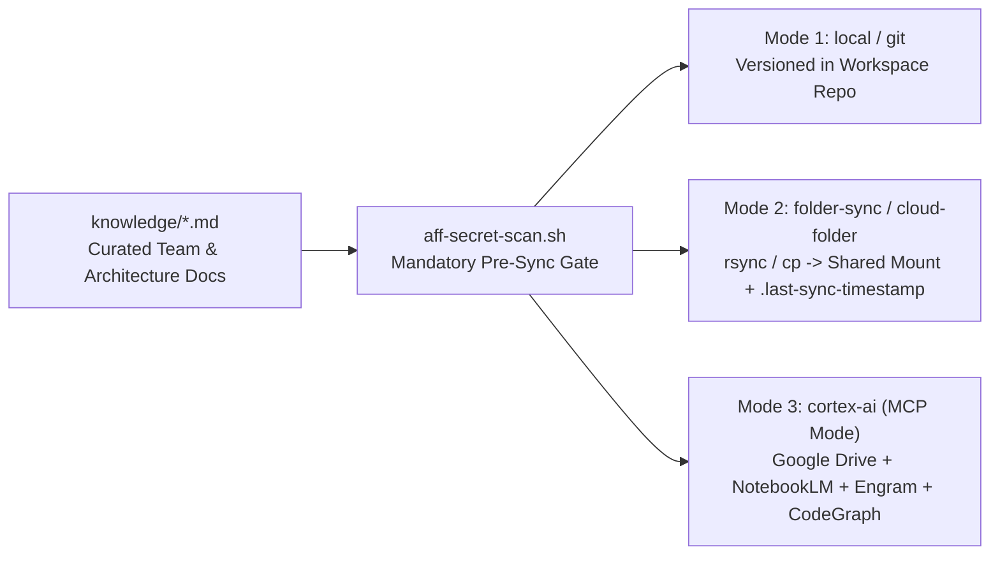

# Security, Data Guardrails & Knowledge Synchronization Manual

> **Back to Portal:** [`docs/en/index.md`](../index.md) | **Español:** [`docs/es/governance/security-and-knowledge-sync.md`](../../es/governance/security-and-knowledge-sync.md)  
> **Related Manuals:** [Installation & Configuration](../guides/installation-and-configuration.md) · [Skills & Stack Profiles Catalog](../catalog/skills-and-profiles.md) · [Lifecycle & Gates](../guides/lifecycle-gates-and-4r.md)

AI coding assistants amplify velocity, but without hard technical guardrails they can accidentally stage hardcoded credentials, paste sensitive customer records into prompt artifacts, write unindexed database queries, or push unsanitized notes to external knowledge stores.

This manual details the deterministic security controls (`scripts/aff-secret-scan.sh`), data and cache guardrails (`db-cache-guardrails`), and pluggable knowledge synchronization workflows (`scripts/aff-knowledge-sync.sh`) built into **`aigile-forge-framework`**.

---

## 1. Automated Secret & Sensitive Pattern Scanner (`./aigile scan`)

`./aigile scan` (backed by `scripts/aff-secret-scan.sh`) runs a deterministic Python 3 regex engine (with an automatic POSIX `grep -E` shell fallback when Python 3 is absent), skipping binary files and build directories (`.git`, `node_modules`, `target`, `build`, `dist`, `.venv`, `venv`, `__pycache__`, `.gradle`, `.idea`).

### 1.1 Built-In Detection Rules

| Rule Code | Pattern Target | Examples Blocked |
|---|---|---|
| **`PRIVATE_KEY`** | Asymmetric PEM/OpenSSH private key headers | PEM `BEGIN ...` + `PRIVATE KEY` armor blocks (RSA, EC, DSA, OpenSSH) |
| **`AWS_ACCESS_KEY`** | AWS IAM access key identifiers | `AKIA` prefix followed by 16 uppercase alphanumeric characters |
| **`GITHUB_TOKEN`** | GitHub PAT, OAuth, App, Server, and Refresh tokens | `ghp_`, `gho_`, `ghu_`, `ghs_`, `ghr_` prefixes followed by 12+ token characters |
| **`GOOGLE_API_KEY`** | Google Cloud / Firebase / Gemini API keys | `AIza` prefix followed by 16+ alphanumeric/`_`/`-` characters |
| **`SLACK_TOKEN`** | Slack bot, app, user, and configuration tokens | `xoxb-`, `xoxa-`, `xoxp-`, `xoxr-`, `xoxs-` token strings |
| **`HARDCODED_SECRET`** | Literal assignments (`>= 8` non-placeholder chars) to `password`, `passwd`, `pwd`, `secret`, `api_key`, `apikey`, `access_token`, `auth_token`, `private_key`, `client_secret` | Quoted literal secret assignments *(ignores `${ENV_VAR}` interpolation and synthetic placeholders like `changeme`, `placeholder`, `redacted`, `example*`, `dummy*`, `mock_*`)* |
| **`RAW_CARD_PAN`** | Unmasked 16-digit payment card numbers (PCI PAN) | Raw 16-digit card sequences outside alphanumeric identifiers |

### 1.2 CLI Usage & Pre-Commit Hook Enforcement

```bash
# 1. Scan staged git diff in the current repository (default)
./aigile scan

# 2. Scan an arbitrary directory or artifact folder before sharing/syncing
./aigile scan --path work/PROJ-210
./aigile scan --path knowledge

# 3. Install automatic .git/hooks/pre-commit blocker
./aigile scan --install-hook
./aigile scan --install-hook --target-dir repositories/billing-api
```

### 1.3 Handling Audited False Positives (`aff-secret-scan:ignore`)
If a test fixture intentionally tests token-format parsing using a non-live synthetic string that triggers a rule, prefer constructing the fixture dynamically at runtime (e.g., `"AKIA" + "0000000000000000"`). When a static line is unavoidable and verified safe by `security`, append an inline `# aff-secret-scan:ignore` suppression comment and document it in `work/<TICKET-ID>/review-4r.md`.

---

## 2. PII, PCI, PHI & Prompt Redaction Governance

Configured in `aff.yaml` under `guardrails.redact_patterns` (`["secrets", "pii", "pci", "phi"]`) and enforced by `security-compliance-audit`:

1. **Sanitize at Intake (`ticket-in.md` & `rca.md`):** Never paste raw production stack traces containing customer names, national identification numbers, email addresses, phone numbers, health records (`phi`), payment card data (`pci`), or bearer JWTs into `work/<TICKET-ID>/` or `odd/tasks/`. Replace them immediately with typed synthetic markers:
   - `<REDACTED:token>`, `<REDACTED:pii>`, `<REDACTED:pan>`, `<REDACTED:phi>`, `<REDACTED:email>`.
2. **Structured Log Hygiene:** Application loggers must never serialize full request bodies, `Authorization` headers, cookies, or raw entity records containing regulated fields. Propagate only safe correlation identifiers (`X-Correlation-Id`, `traceparent`, internal UUIDs).
3. **Client Storage Boundaries:** Never persist session tokens or regulated payloads in browser `localStorage`/`sessionStorage`, Android cleartext `SharedPreferences`, or iOS `UserDefaults`.

---

## 3. Database Index & Cache Key/TTL Guardrails

Unbounded queries and immortal cache keys cause the majority of preventable production outages and cross-tenant data leaks. `aff.yaml` enforces three hard data invariants via `db-cache-guardrails` and `data-sql-nosql-cache`:

1. **Mandatory Query Indexing (`guardrails.require_db_indexes: true`):**
   - Every transactional SQL/NoSQL query filtering (`WHERE`), joining (`JOIN`), or sorting (`ORDER BY`) on a non-trivial table must map to an explicit single-column or composite index declared in schema migrations and documented in `work/<TICKET-ID>/contract.md`.
   - Reversible expand-and-contract migrations are mandatory so N-1 application pods remain functional during rolling deployments or instant rollbacks.
2. **Mandatory Finite Cache TTL (`guardrails.require_cache_ttl: true`):**
   - Calling `SET` without an expiration (`EX` / `PX` / finite TTL duration) is strictly prohibited and flagged as a `HIGH` Risk/Resilience defect during Pass 1 4R review.
   - Document explicit TTL values and invalidation triggers in `contract.md` (including jitter where cache stampedes are possible).
3. **Canonical Namespaced Cache Keys (`guardrails.cache_key_pattern`):**
   - Default pattern: **`{namespace}:{domain}:{service}:{entity}:{id}`**
   - Example (`project.namespace: "billing"`): `billing:invoicing:refund-svc:refund-status:inv_84920`
   - Prevents key collisions across shared Redis/Memcached clusters and makes prefix metrics/eviction deterministic. Never embed raw PII (such as national IDs or raw emails) inside cache keys; hash with salted SHA256 or use opaque surrogate IDs.

---

## 4. Knowledge Base Synchronization (`local`, `folder-sync`, `cortex-ai`)

Curated project knowledge lives in `knowledge/` (`team-roster.md`, `domain-overview.md`, `architecture-map.md`, `team-workflow.md`, and ADRs). `./aigile sync` (`scripts/aff-knowledge-sync.sh`) supports three synchronization backends controlled by `knowledge.mode` in `aff.yaml`:

> **Automatic Pre-Sync Security Gate:** Before any `--sync` operation executes, `aff-knowledge-sync.sh` automatically runs `scripts/aff-secret-scan.sh --path knowledge` and aborts immediately if any secret or raw PAN is detected.



### Mode 1: `local` (or `git` — Default)
- **When to use:** Single-repository or committed multi-root workspaces where `knowledge/*.md` travels directly inside Git pull requests.
- **Commands:**
  ```bash
  ./aigile sync --status
  ./aigile sync --sync
  ```

### Mode 2: `folder-sync` (or `cloud-folder` — Zero-MCP Shared Directory Mirror)
- **When to use:** Restricted corporate environments (`harnesses.mode: "zero-mcp"`) that synchronize team documentation via an enterprise network share, NFS/SMB volume, or desktop-mounted cloud sync folder (e.g., Google Drive desktop mount, Dropbox, or iCloud Drive folder) without running MCP servers.
- **Configuration (`aff.yaml`):**
  ```yaml
  knowledge:
    mode: "folder-sync"
    sync_path: "~/shared-team-drive/billing-platform"
  ```
- **Commands:**
  ```bash
  # Preview synchronization without writing files
  ./aigile sync --sync --dry-run

  # Execute secret scan + rsync/cp mirror + write UTC .last-sync-timestamp
  ./aigile sync --sync
  # Or override destination ad hoc via flag or AFF_KNOWLEDGE_SYNC_DEST:
  ./aigile sync --sync --mode folder-sync --dest /mnt/team-share/billing-platform
  ```

### Mode 3: `cortex-ai` (Connected Second-Brain via MCP)
- **When to use:** Teams operating with `harnesses.mode: "mcp"` that want persistent cross-session decision recall, AST-level code impact graphs, canonical cloud document storage, and grounded semantic Q&A.
- **Four Connected MCP Pillars (`mcp/*.json`):**
  1. **Google Drive (`mcp/google-drive.json`):** Canonical cloud storage for sanitized specs, ADRs, and team registries under `${DRIVE_ROOT_FOLDER_ID}`.
  2. **NotebookLM (`mcp/notebooklm.json`):** Derived semantic index (`${NOTEBOOKLM_NOTEBOOK_ID}`) providing citation-backed answers across curated architecture and domain docs.
  3. **Engram (`mcp/engram.json`):** Persistent cross-session engineering memory (`${ENGRAM_PROJECT}`) storing architectural decisions, bug root causes, and Drive/NotebookLM cross-reference pointers.
  4. **CodeGraph (`mcp/codegraph.json`):** Local AST graph server (`${CODEGRAPH_WORKSPACE}`) providing call-graph and blast-radius analysis during `contract-first-design` and `incident-rca-debugging`.
- **Activation & Operational Workflow:**
  ```bash
  # 1. Set harnesses.mode: "mcp" and knowledge.mode: "cortex-ai" in aff.yaml, export env vars, and sync:
  export DRIVE_ROOT_FOLDER_ID="<your-folder-id>"
  export NOTEBOOKLM_NOTEBOOK_ID="<your-notebook-id>"
  export ENGRAM_PROJECT="billing-platform"
  ./aigile harness sync all --mode mcp

  # 2. Check status & guided workflow
  ./aigile sync --mode cortex-ai --sync
  ```
  Then invoke the five procedural skills inside your AI harness: `cortex-ai-init` (one-time bootstrap) -> `cortex-ai-sync` (after Phase 7 curation) -> `cortex-ai-ask` / `cortex-ai-onboard` / `cortex-ai-status`.
