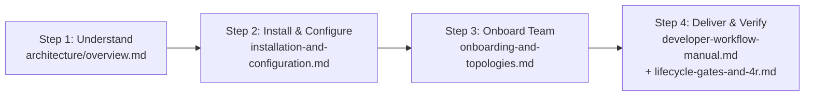

# aigile-forge-framework — Documentation Portal

> **Language / Idioma:** **English** | [Español (`docs/es/index.md`)](../es/index.md)  
> **Repository Root:** [`README.md`](../../README.md) | **Canonical Contract:** [`AGENTS.md`](../../AGENTS.md) | **License:** [`LICENSE`](../../LICENSE) (MIT)

Welcome to the official operational documentation portal for **`aigile-forge-framework`**.

`aigile-forge-framework` is a vendor-neutral, organization-agnostic engineering harness and delivery governance framework. It lets software teams maintain a single declarative specification (`aff.yaml`, `AGENTS.md`, `agents/`, `skills/`, `profiles/`, `prompts/`, `templates/`, and `mcp/`) and deterministically project native configurations to **Claude Code**, **OpenCode**, **Google Antigravity**, **OpenAI Codex**, and **GitHub Copilot**.

---

## 1. Quick Navigation — Complete Manual Suite

All 10 manuals in `docs/en/` have 1:1 Spanish counterparts under [`docs/es/`](../es/index.md):

| Manual | Category | Primary Topics Covered |
|---|---|---|
| **[1. Documentation Portal](index.md)** *(this page)* | Portal | Role-based entry points, recommended reading order, CLI quick reference, and core principles. |
| **[2. Universal Architecture & Projection](architecture/overview.md)** | Architecture | 3-layer model (canonical vs projected vs runtime), Mermaid data-flow, `zero-mcp` vs `mcp`, `.git/info/exclude`, SHA256 RDD cryptography. |
| **[3. Installation & Configuration](guides/installation-and-configuration.md)** | Setup & Config | OS prerequisites (Linux, macOS, WSL2, Git-Bash), installation modes, complete `aff.yaml` v1.0 schema reference, env vars, pre-commit hooks, troubleshooting. |
| **[4. Onboarding & Workspace Topologies](guides/onboarding-and-topologies.md)** | Team Setup | Interactive `./aigile init` vs CI bootstrap, 6-dimension `/init-team` interview, `single-repo` / `worktrees` / `multi-root`, issue trackers, 3-point PERT calibration. |
| **[5. Developer Workflow Manual](guides/developer-workflow-manual.md)** | Operations | Invoking agents/prompts in all 5 harnesses, end-to-end feature playbook, `<30s` context switching without `git stash`, hotfix `H` RCA, multi-repo `L` parity. |
| **[6. Lifecycle, Gates `G1`–`G4`, 4R & Receipts](guides/lifecycle-gates-and-4r.md)** | Governance | Phases 0–7 exit criteria, `S/M/L/H` ceremony matrix, `G1` (`G1a`/`G1b`)–`G4` checklists, two-pass 4R + Refuter protocol, JSON receipt anatomy. |
| **[7. Harness Compatibility Matrix](harnesses/compatibility-matrix.md)** | Tooling | Exact generated files per harness, `aff-harness.sh` frontmatter & JSON transforms, `--symlink` vs `--copy`, `zero-mcp` policy enforcement. |
| **[8. Agents & Slash Prompts Catalog](catalog/agents-and-prompts.md)** | Reference | All 10 specialist agents, 7 `delivery` sub-roles, and 9 slash prompts with inputs, outputs, handoff chains, and examples. |
| **[9. Skills & Stack Profiles Catalog](catalog/skills-and-profiles.md)** | Reference | All 14 core procedural skills, 5 optional `cortex-ai-*` skills, 7 stack profiles (`applyTo` globs & rules), and authoring custom extensions. |
| **[10. Security & Knowledge Synchronization](governance/security-and-knowledge-sync.md)** | Security & Ops | `aff-secret-scan.sh` rules, PII/PCI/PHI redaction, DB index & finite cache TTL contracts, and `local` / `folder-sync` / `cortex-ai` sync operations. |

---

## 2. Role-Based Documentation Map

Choose the path tailored to your day-to-day responsibilities on the project team:

### Technical Lead & Principal Architect
1. Start with **[Universal Architecture & Projection](architecture/overview.md)** to understand how canonical files project into developer IDEs and CLIs without drift.
2. Follow **[Installation & Configuration](guides/installation-and-configuration.md)** to configure `aff.yaml`, `governance`, `profiles.enabled`, and `harnesses.mode`.
3. Run **[Team Onboarding & Topologies](guides/onboarding-and-topologies.md)** (`./aigile init` + `/init-team`) to establish `single-repo`, `worktrees`, or `multi-root` isolation and PERT calibration.
4. Reference **[Skills & Stack Profiles Catalog](catalog/skills-and-profiles.md)** to tailor architectural guardrails or add custom stack profiles.

### Software Engineer (Backend, Frontend, Mobile)
1. Complete local prerequisites in **[Installation & Configuration](guides/installation-and-configuration.md)** (`./aigile doctor` and `./aigile scan --install-hook`).
2. Keep **[Developer Workflow Manual](guides/developer-workflow-manual.md)** open as your operational runbook for feature delivery, context switching via `./aigile worktree`, hotfixes, and multi-channel parity.
3. Consult **[Agents & Slash Prompts Catalog](catalog/agents-and-prompts.md)** when invoking `/aff-intake`, `/contract-first`, `/work-units`, or `/review-4r` inside your preferred harness.

### Quality Engineering (QA) & Code Reviewer
1. Study **[Lifecycle, Gates `G1`–`G4`, 4R & Receipts](guides/lifecycle-gates-and-4r.md)** for the clean-session two-pass 4R protocol (**Risk, Requirements, Regression, Resilience** + Refuter) and Gate `G3`/`G4` criteria.
2. Verify tamper-evident execution proofs (`./aigile receipt generate` and `./aigile receipt verify --verify-head`) before approving releases.
3. Use `/parity-check` from **[Agents & Slash Prompts Catalog](catalog/agents-and-prompts.md)** whenever `governance.multi_channel_parity: true`.

### Application Security, DevOps & Knowledge Curator
1. Review **[Security & Knowledge Synchronization](governance/security-and-knowledge-sync.md)** to enforce secret scanning, database index / cache TTL guardrails, and sanitized knowledge replication (`local`, `folder-sync`, or `cortex-ai`).
2. Audit harness projection hygiene (`zero-mcp` vs `mcp`) using **[Harness Compatibility Matrix](harnesses/compatibility-matrix.md)** (`./aigile harness check`).

---

## 3. Recommended 4-Step Learning Path

1. **Understand the Model (15 min):** Read [Universal Architecture & Projection](architecture/overview.md) to see why `aigile-forge-framework` separates canonical definitions, projected harness targets, and runtime ticket state.
2. **Bootstrap Locally (10 min):** Run `./aigile init`, `./aigile doctor`, and `./aigile harness check` using [Installation & Configuration](guides/installation-and-configuration.md).
3. **Hydrate Team Context (20 min):** Execute `/init-team` with the `onboarding` agent ([Team Onboarding & Topologies](guides/onboarding-and-topologies.md)) to populate `knowledge/` and select active stack profiles.
4. **Ship Your First Governed Ticket (30 min):** Walk through Workflow 1 in the [Developer Workflow Manual](guides/developer-workflow-manual.md) on a small (`S`) or medium (`M`) task, sealing Gate `G3`/`G4` with `./aigile receipt`.

---

## 4. Core Design Principles

1. **Single Canonical Source, Five Harnesses:** Author rules, specialist agents, procedural skills, and stack profiles once; project deterministically via `./aigile harness sync` with zero manual copy-paste drift.
2. **Strict Organization & Vendor Neutrality:** Zero hardcoded company names, proprietary trackers, or rigid team structures. Everything adapts declaratively through `aff.yaml`.
3. **Proportional Ceremony (`S / M / L / H`):** Lightweight inline TDD for small bug fixes (`S`); rigorous contract-first design, isolated worktrees, and multi-stage human gates for cross-repository features (`L`) and production hotfixes (`H`).
4. **Cryptographic Verification Over Claims:** Gate approvals rely on reproducible test execution sealed with SHA256 digests (`./aigile receipt`) and automated pre-commit secret scanning (`./aigile scan`).
5. **Cold-Resumable Continuity:** Structured Markdown session journals (`work/sessions/`) and isolated Git worktrees (`worktrees/<TICKET-ID>/`) eliminate `git stash` loss and let any engineer or harness resume cold in seconds.

---

## 5. Essential CLI Quick Reference

| Daily Task | Command | Reference Manual |
|---|---|---|
| Bootstrap workspace interactively or in CI | `./aigile init` | [Onboarding & Topologies](guides/onboarding-and-topologies.md) |
| Project canonical files to all 5 harnesses | `./aigile harness sync all` | [Harness Compatibility Matrix](harnesses/compatibility-matrix.md) |
| Run OS, manifest, and schema diagnostics | `./aigile doctor && ./aigile harness check` | [Installation & Configuration](guides/installation-and-configuration.md) |
| Start isolated ticket session & Git worktree | `./aigile session start <ID> && ./aigile worktree create <ID>` | [Developer Workflow Manual](guides/developer-workflow-manual.md) |
| Seal & verify Gate `G3`/`G4` SHA256 receipt | `./aigile receipt generate <ID> G4 -- <test-cmd>` | [Lifecycle, Gates & 4R](guides/lifecycle-gates-and-4r.md) |
| Scan diffs/paths & synchronize `knowledge/` | `./aigile scan && ./aigile sync --sync` | [Security & Knowledge Sync](governance/security-and-knowledge-sync.md) |

