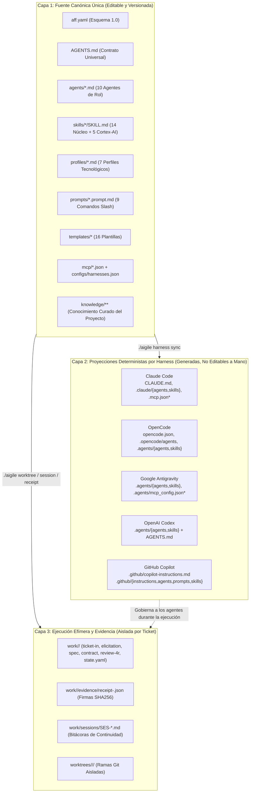

# Arquitectura Universal y Proyección Determinista

> **Volver al Portal:** [`docs/es/index.md`](../index.md) | **English:** [`docs/en/architecture/overview.md`](../../en/architecture/overview.md)

Este documento describe la arquitectura interna de **`aigile-forge-framework`**, su separación estricta en tres capas, el mecanismo determinista de proyección hacia cinco harnesses de IA, los modos operativos `zero-mcp` frente a `mcp`, el aislamiento sin huella en Git (`--zero-footprint`) y el modelo criptográfico de recibos SHA256.

---

## 1. Modelo Arquitectónico de Tres Capas

El problema habitual al adoptar múltiples asistentes de IA en un equipo de desarrollo (por ejemplo, desarrolladores backend usando **Claude Code** u **OpenCode**, ingenieros frontend en **VS Code con GitHub Copilot** y especialistas usando **Google Antigravity** o **Codex**) es la fragmentación de reglas: mantener instrucciones duplicadas en `CLAUDE.md`, `.github/copilot-instructions.md` y `.agents/` provoca deriva inmediata.

`aigile-forge-framework` resuelve este problema dividiendo el espacio de trabajo en **tres capas desacopladas** con reglas claras de propiedad y ciclo de vida:



### Árbol de Directorios Canónico (Capa 1)

```text
aigile-forge-framework/
├── aigile                     # Punto de entrada CLI unificado multiplataforma (Bash + Python 3)
├── aff.yaml                   # Manifiesto declarativo de proyecto, equipo, topología y gobierno (v1.0)
├── AGENTS.md                  # Contrato operativo universal compartido por todos los harnesses
├── LICENSE                    # Licencia abierta MIT
├── agents/                    # 10 definiciones de agentes especializados neutrales al harness
├── skills/                    # 14 habilidades de núcleo + 5 habilidades opcionales cortex-ai-*
├── profiles/                  # 7 perfiles enchufables de reglas por pila tecnológica
├── prompts/                   # 9 flujos interactivos de comandos slash (*.prompt.md)
├── templates/                 # 16 plantillas parametrizadas en Markdown, YAML y JSON
├── mcp/                       # 4 fragmentos parametrizados de servidores MCP (*.json)
├── configs/                   # Matriz declarativa de capacidades por harness (harnesses.json)
├── scripts/                   # 7 scripts operativos deterministas (aff-*.sh)
├── knowledge/                 # Documentación viva de dominio, arquitectura, equipo y flujo
└── odd/tasks/                 # Documentos vivos de unidades de trabajo Organic Driven Development
```

**Invariante fundamental:** ningún archivo perteneciente a la **Capa 2** debe editarse manualmente. Cualquier cambio a una regla, perfil o agente se realiza en la **Capa 1** y se materializa ejecutando `./aigile harness sync`.

---

## 2. Flujo del Proyector Determinista (`scripts/aff-harness.sh`)

Cuando un ingeniero o un pipeline ejecuta `./aigile harness sync`, el motor en `scripts/aff-harness.sh` ejecuta una tubería determinista e idempotente:

```mermaid
sequenceDiagram
    participant Dev as Desarrollador / CI
    participant CLI as ./aigile harness sync
    participant Manifest as aff.yaml + mcp/*.json
    participant FS as Árbol del Espacio de Trabajo

    Dev->>CLI: ./aigile harness sync all [--mode zero-mcp|mcp] [--symlink|--copy]
    CLI->>Manifest: Carga aff.yaml (profiles.enabled, harnesses.mode, project, team)
    alt Modo Efectivo == "mcp"
        CLI->>Manifest: Fusiona mcp/*.json preservando variables ${ENV_VAR}
    else Modo Efectivo == "zero-mcp"
        CLI->>FS: Elimina u omite .mcp.json y .agents/mcp_config.json; fija opencode.json {"mcp":{}}
    end
    CLI->>FS: Genera CLAUDE.md + .claude/agents/*.md + .claude/skills
    CLI->>FS: Genera .agents/agents/*.md + .opencode/agents/*.md + opencode.json + .agents/skills
    CLI->>FS: Genera .github/copilot-instructions.md + .github/instructions/*.instructions.md
    CLI->>FS: Genera .github/agents/aff-*.agent.md + .github/prompts/*.prompt.md + .github/skills
    CLI-->>Dev: Salida 0 (Proyección completada; verificable con ./aigile harness check)
```

### Transformaciones Específicas por Destino
1. **Agentes Estándar (`.claude/agents/`, `.agents/agents/`, `.opencode/agents/`):** Normaliza el encabezado YAML con `name`, `description` y `mode: all`, preservando intacto el cuerpo operativo del agente.
2. **Agentes Personalizados de GitHub Copilot (`.github/agents/aff-<rol>.agent.md`):** Antepone el prefijo `aff-` para evitar colisiones en el selector de agentes de VS Code e inyecta `tools: ['read', 'search', 'edit', 'execute']`.
3. **Perfiles Tecnológicos en Copilot (`.github/instructions/<perfil>.instructions.md`):** Filtra exclusivamente los perfiles listados en `aff.yaml -> profiles.enabled` y conserva o infiere el patrón glob `applyTo` para que VS Code inyecte únicamente las reglas pertinentes al archivo abierto.

---

## 3. Modos Operativos: `zero-mcp` frente a `mcp` (`cortex-ai`)

`aigile-forge-framework` soporta nativamente organizaciones con políticas de seguridad estrictas y equipos con ecosistemas conectados de conocimiento:

| Dimensión Arquitectónica | Modo `zero-mcp` (Predeterminado) | Modo `mcp` / `cortex-ai` |
|---|---|---|
| **Superficie de ejecución** | 100% archivos locales Markdown, YAML, JSON y scripts Bash/Python estándar. | Añade servidores MCP locales o remotos comunicados vía `stdio`. |
| **Huella de archivos MCP** | Cero: `.mcp.json` y `.agents/mcp_config.json` se eliminan activamente si existían; `opencode.json` emite `"mcp": {}`. | Genera `.mcp.json` (Claude), `.agents/mcp_config.json` (Antigravity) y puebla `"mcp"` en `opencode.json`. |
| **Manejo de credenciales** | No requiere tokens externos ni claves de API para operar el ciclo completo. | Los fragmentos en `mcp/*.json` contienen únicamente marcadores `${VAR_ENTORNO}`, nunca secretos en texto plano. |
| **Memoria y contexto** | `knowledge/*.md`, `work/<ID>/state.yaml` y `work/sessions/SES-*.md` (+ `./aigile sync --mode folder-sync`). | Activa `engram`, `codegraph`, `google-drive` y `notebooklm` junto con las 5 habilidades `skills/cortex-ai-*`. |
| **Auditoría de cumplimiento** | Verificada automáticamente por `./aigile harness check` (falla con código `1` si detecta un descriptor MCP residual). | Verificada por `./aigile harness check` validando el esquema JSON de todos los descriptores generados. |

---

## 4. Mecánica de Exclusión Local y `--zero-footprint`

En repositorios existentes donde un equipo desea adoptar `aigile-forge-framework` localmente sin modificar el `.gitignore` compartido del repositorio remoto ni introducir archivos de gobernanza en los Pull Requests de aplicación, la CLI utiliza `.git/info/exclude`:

1. **Comportamiento base en todo repositorio Git:** `./aigile init` registra siempre `work/` y `worktrees/` dentro de `.git/info/exclude` (resuelto mediante `git rev-parse --git-path info/exclude`, compatible incluso dentro de sub-árboles de trabajo). Esto impide que artefactos efímeros por ticket o worktrees anidados se agreguen por accidente a un commit.
2. **Bandera `--zero-footprint` (`./aigile init --zero-footprint`):** Amplía `.git/info/exclude` para excluir localmente todos los archivos de manifiesto y proyecciones generadas:
   - `aff.yaml`, `CLAUDE.md`, `.claude/`, `.mcp.json`, `opencode.json`, `.agents/`, `.opencode/`
   - `.github/copilot-instructions.md`, `.github/instructions/`, `.github/agents/`, `.github/prompts/`, `.github/skills/`
3. **Topología `multi-root`:** Cuando se requiere separar físicamente la gobernanza respecto de múltiples microservicios, el directorio coordinador (`00-<proyecto>-hub`) aloja `aff.yaml`, `knowledge/` y `work/`, manteniendo el historial Git de los repositorios bajo `repositories/*` completamente libre de archivos del framework.

---

## 5. Integridad Criptográfica Determinista (Recibos SHA256 RDD)

Los modelos de lenguaje pueden afirmar en una conversación que las pruebas pasaron sin haberlas ejecutado sobre el último cambio. Para erradicar esta ambigüedad, `aigile-forge-framework` implementa **Receipt-Driven Development (RDD)** mediante `scripts/aff-receipt.sh`:

1. **Ejecución encapsulada:** `./aigile receipt generate <TICKET-ID> <GATE> -- <comando...>` captura el commit actual (`git rev-parse HEAD`), calcula el resumen SHA256 del árbol de cambios no confirmados (`git diff HEAD --no-ext-diff` -> `working_tree_diff_sha256`), ejecuta el comando real, captura su código de salida y calcula el resumen SHA256 de toda la salida estándar y de error (`output_sha256`).
2. **Serialización canónica determinista:** Todos los metadatos (`schema_version`, `ticket_id`, `gate`, `command`, `command_argv`, `exit_code`, `status`, `timestamp_utc`, `git_head`, `working_tree_diff_sha256`, `output_sha256`) se serializan en JSON canónico con claves ordenadas alfabéticamente y sin espacios superfluos (`sort_keys=True, separators=(",", ":"), ensure_ascii=True`).
3. **Sello contra adulteración (`receipt_sha256`):** Se calcula el digest SHA256 sobre esos bytes exactos y se inyecta como `receipt_sha256` en `work/<TICKET-ID>/evidence/receipt-<GATE>.json`.
4. **Verificación matemática independiente:** Al invocar `./aigile receipt verify <archivo> --verify-head`, el verificador extrae `receipt_sha256`, recalcula el hash canónico del resto del objeto JSON y comprueba además que `git_head` coincida exactamente con el `HEAD` actual del repositorio. Si un solo carácter del recibo fue editado manualmente o si se añadieron commits posteriores sin volver a correr las pruebas, la verificación falla con código de salida `1`.
