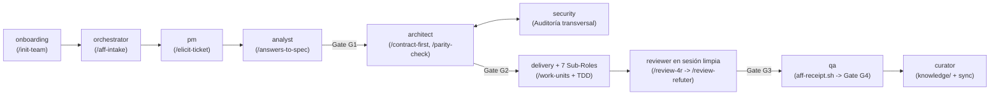

# Catálogo de Agentes de Rol, Sub-Roles de Entrega y Slash Prompts

> **Volver al Portal:** [`docs/es/index.md`](../index.md) | **English:** [`docs/en/catalog/agents-and-prompts.md`](../../en/catalog/agents-and-prompts.md)

Este catálogo documenta en detalle los **10 agentes principales** (`agents/*.md`), los **7 sub-roles especializados de implementación** coordinados dentro de `agents/delivery.md`, los **9 comandos slash interactivos** (`prompts/*.prompt.md`) y su relación directa con las **16 plantillas canónicas** (`templates/*`) de **`aigile-forge-framework`**.

---

## 1. Cadena de Colaboración y Handoffs entre Agentes



Cada transición entre agentes se articula a través de artefactos verificables en `work/<TICKET-ID>/` y del archivo de estado `work/<TICKET-ID>/state.yaml`, nunca mediante memoria conversacional implícita. Esto garantiza que un desarrollador pueda ejecutar `/elicit-ticket` en **GitHub Copilot**, `/contract-first` en **Claude Code** y `/review-4r` en **OpenCode** o **Antigravity** sin perder continuidad.

---

## 2. Los 10 Agentes Principales (`agents/*.md`)

En Claude Code, OpenCode, Antigravity y Codex se invocan por su identificador canónico (`pm`, `architect`, `reviewer`); en GitHub Copilot aparecen en el selector de agentes con el prefijo `aff-` (`aff-pm`, `aff-architect`, `aff-reviewer`).

| # | Agente Canónico | Proyección Copilot | Propósito y Responsabilidad | Entradas Principales | Salidas y Entregables |
|---|---|---|---|---|---|
| 1 | **`onboarding`** (`agents/onboarding.md`) | `aff-onboarding.agent.md` | Conduce la entrevista estructurada de 6 dimensiones para adaptar el framework a cualquier equipo, dominio y pila tecnológica. | Respuestas del Líder Técnico, estructura de repositorios. | `aff.yaml` (v2.0), `knowledge/*.md`, `<id>.code-workspace` (si `multi-root`). |
| 2 | **`orchestrator`** (`agents/orchestrator.md`) | `aff-orchestrator.agent.md` | Recibe tickets crudos, redacta datos sensibles, clasifica el tamaño (`S/M/L/H`), gestiona worktrees/sesiones y vigila la integridad SHA256 de `G1`–`G4`. | Descripción del ticket, `aff.yaml`. | `work/<ID>/ticket-in.md`, `work/<ID>/state.yaml`, `worktrees/<ID>/`. |
| 3 | **`pm`** (`agents/pm.md`) | `aff-pm.agent.md` | Formula hipótesis de dominio, detecta ambigüedades bloqueantes (`<= 10` preguntas `P1` con opción por defecto recomendada) y calcula estimación PERT. | `ticket-in.md`, `knowledge/domain-overview.md`. | `work/<ID>/elicitation.md` (hipótesis, preguntas `P1` y pronóstico PERT). |
| 4 | **`analyst`** (`agents/analyst.md`) | `aff-analyst.agent.md` | Hidrata las respuestas confirmadas en criterios de aceptación Gherkin (*Given/When/Then*), corta alcances por repositorio y valida `G1` (DoR). | `elicitation.md` respondido, `aff.yaml`. | `work/<ID>/spec.md`, `work/<ID>/slices/<repo>.md`, `gate-record.md` (`G1`). |
| 5 | **`architect`** (`agents/architect.md`) | `aff-architect.agent.md` | Diseña contratos primero (REST/GraphQL/AsyncAPI), compatibilidad N/N-1, índices de base de datos, claves de caché con TTL y paridad 1:1 multicanal. | `spec.md`, `knowledge/architecture-map.md`, `profiles/*.md`. | `work/<ID>/contract.md` (con matriz de paridad opcional para `G2`). |
| 6 | **`security`** (`agents/security.md`) | `aff-security.agent.md` | Audita controles OWASP Top 10, prevención de fugas de secretos/PII/PCI/PHI, índices transaccionales, TTLs, contenedores sin root y llaveros móviles. | `spec.md`, `contract.md`, diff de código. | `work/<ID>/security-review.md`, validaciones integradas en `G2` y `G3`. |
| 7 | **`qa`** (`agents/qa.md`) | `aff-qa.agent.md` | Diseña matrices de pruebas trazables a cada `AC-#`, verifica el cierre de la revisión 4R y sella recibos criptográficos SHA256 (`./aigile receipt`). | `spec.md`, `contract.md`, `review-4r.md`, suites de prueba. | `work/<ID>/test-plan.md`, `work/<ID>/evidence/receipt-G3.json` y `receipt-G4.json`. |
| 8 | **`curator`** (`agents/curator.md`) | `aff-curator.agent.md` | Mantiene viva la base `knowledge/`, redacta ADRs, detecta deriva documental tras cada entrega y ejecuta sincronización (`local`, `folder-sync`, `cortex-ai`). | `spec.md`, `contract.md`, `rca.md`, sesiones cerradas. | Documentos actualizados en `knowledge/`, ADRs y puntos de control limpios. |
| 9 | **`delivery`** (`agents/delivery.md`) | `aff-delivery.agent.md` | Ejecuta las tajadas de código por repositorio combinando ODD (`odd/tasks/`), TDD estricto en unidades `<= 400` líneas y coordinación de 7 sub-roles. | `spec.md` (`G1`), `contract.md` (`G2`), `profiles/*.md`. | `odd/tasks/<id>-<slug>.md`, commits TDD limpios, `work/<ID>/pr.md`. |
| 10 | **`reviewer`** (`agents/reviewer.md`) | `aff-reviewer.agent.md` | Opera en **sesión limpia** para ejecutar la auditoría determinista 4R (Pasada 1) y la refutación adversarial de falsos positivos (Pasada 2) antes de `G3`. | Diff del repositorio, `spec.md`, `contract.md`, `profiles/*.md`. | `work/<ID>/review-4r.md` con veredicto `APPROVED FOR GATE G3` o `BLOCKED`. |

### Restricciones de Separación de Funciones por Agente
- **`pm` y `analyst` no modifican código de aplicación:** Su responsabilidad termina en especificaciones verificables y cortes de repositorio aprobados en `G1`.
- **`architect` congela interfaces antes del paralelismo:** Ningún cliente Web o Móvil codifica contra suposiciones no escritas en `contract.md`.
- **`delivery` nunca autoaprueba `G3`:** Queda prohibido que la misma sesión conversacional que implementó `T1..Tn` emita el veredicto final de `review-4r.md`.
- **`orchestrator` bloquea saltos de compuerta ante mutaciones:** Si el hash SHA256 actual de `spec.md` o `contract.md` difiere del registrado en `state.yaml`, exige revalidar la compuerta afectada antes de continuar.

---

## 3. Los 7 Sub-Roles Especializados de `delivery` (`agents/delivery.md`)

Para evitar escribir código improvisado sin inspección previa ni pruebas reproducibles, el agente `delivery` estructura internamente su actuación en siete sub-roles secuenciales:

1. **`code-analyzer` (Solo Lectura):**
   Inspecciona manifiestos de compilación (`pom.xml`, `build.gradle.kts`, `package.json`, `pyproject.toml`, `go.mod`), versiones reales del lenguaje, esquemas de migración y trazas correlacionadas (`X-Correlation-Id` / `traceparent`) antes de proponer cualquier cambio o diagnosticar un incidente.
2. **`designer`:**
   Modela la solución técnica de la tajada dentro del documento vivo `odd/tasks/<ticket>-<slug>.md`, alineándola estrictamente con `contract.md` y los perfiles habilitados en `aff.yaml`.
3. **`planner`:**
   Particiona el diseño en unidades de trabajo atómicas (`T1`, `T2`, …) cohesivas y verificables de **`<= 400` líneas de código**, ordenadas desde el dominio y pruebas de contrato hacia persistencia, transporte/UI e integración.
4. **`implementer`:**
   Ejecuta el ciclo **Red-Green-Refactor** por cada unidad `T#`, respeta los guardrails de base de datos, caché y seguridad, y registra Conventional Commits en inglés sin jamás incluir `Co-Authored-By`.
5. **`tester`:**
   Ejecuta en primer plano las suites unitarias, de integración, de contrato y de idempotencia/concurrencia, verificando códigos de salida deterministas (`0`).
6. **`reviewer` (Puente de Delegación):**
   Prepara el diff limpio y solicita o dispara la transferencia hacia una sesión independiente del agente `reviewer` para correr las dos pasadas 4R.
7. **`documenter`:**
   Actualiza especificaciones OpenAPI/AsyncAPI en el repositorio, redacta el paquete de Pull Request (`work/<ID>/pr.md`) y documenta pasos de despliegue y reversión.

---

## 4. Catálogo de los 9 Slash Prompts (`prompts/*.prompt.md`)

Cada prompt carga automáticamente el agente responsable, las habilidades (`skills`) requeridas y la plantilla canónica en `templates/`:

| # | Comando Slash | Archivo Canónico | Agente Destino | Plantilla Asociada (`templates/`) | Cuándo Invocarlo y Salida |
|---|---|---|---|---|---|
| 1 | **`/init-team`** | `prompts/init-team.prompt.md` | `onboarding` | `aff.template.yaml`, `{team-roster,domain-overview,architecture-map,team-workflow}.template.md`, `workspace.code-workspace.template.json` | Al iniciar un proyecto o incorporar un equipo nuevo; actualiza `aff.yaml` y `knowledge/`. |
| 2 | **`/aff-intake`** | `prompts/aff-intake.prompt.md` | `orchestrator` | `ticket-in.template.md`, `state.template.yaml` | Al abrir cualquier ticket o incidente; sanitiza entradas y clasifica `S/M/L/H` en `work/<ID>/`. |
| 3 | **`/elicit-ticket`** | `prompts/elicit-ticket.prompt.md` | `pm` | `elicitation.template.md` | Cuando un ticket `M`/`L` presenta dudas funcionales o requiere cálculo PERT en `elicitation.md`. |
| 4 | **`/answers-to-spec`** | `prompts/answers-to-spec.prompt.md` | `analyst` | `spec.template.md`, `task-slice.template.md`, `gate-record.template.md` | Tras responder `elicitation.md`; genera `spec.md` (`AC-#`), `slices/*.md` y prepara `G1`. |
| 5 | **`/contract-first`** | `prompts/contract-first.prompt.md` | `architect` | `contract.template.md` | Previo a codificar cambios de API, eventos, tablas o caché; produce `contract.md` para `G2`. |
| 6 | **`/parity-check`** | `prompts/parity-check.prompt.md` | `architect` | `contract.template.md` (sección de paridad) | Cuando intervienen Web y Móvil nativo; audita correspondencia 1:1 de reglas, campos y errores. |
| 7 | **`/work-units`** | `prompts/work-units.prompt.md` | `delivery` | `odd-task.template.md` | Tras `G1`/`G2`; descompone en unidades TDD `T1..Tn` (`<= 400` LoC) en `odd/tasks/<id>-<slug>.md`. |
| 8 | **`/review-4r`** | `prompts/review-4r.prompt.md` | `reviewer` | `review-4r.template.md` | En sesión limpia al concluir la implementación (Pasada 1: hallazgos candidatos 4R con prueba). |
| 9 | **`/review-refuter`** | `prompts/review-refuter.prompt.md` | `reviewer` | `review-4r.template.md` | Pasada 2 inmediata tras `/review-4r`; descarta falsos positivos con `archivo:línea` y emite veredicto `G3`. |

---

## 5. Mapa Completo de las 16 Plantillas Canónicas (`templates/*`)

Además de las plantillas invocadas por los 9 comandos slash, el directorio `templates/` proporciona estructuras deterministas para todo el ciclo de vida:

| Plantilla en `templates/` | Destino Renderizado | Consumidor Principal |
|---|---|---|
| `aff.template.yaml` | `aff.yaml` | `./aigile init`, `onboarding` (`/init-team`) |
| `workspace.code-workspace.template.json` | `<project-slug>.code-workspace` | `./aigile init --topology multi-root` |
| `team-roster.template.md` | `knowledge/team-roster.md` | `./aigile init`, `onboarding`, `curator` |
| `domain-overview.template.md` | `knowledge/domain-overview.md` | `./aigile init`, `onboarding`, `pm`, `curator` |
| `architecture-map.template.md` | `knowledge/architecture-map.md` | `./aigile init`, `onboarding`, `architect`, `curator` |
| `team-workflow.template.md` | `knowledge/team-workflow.md` | `./aigile init`, `onboarding`, `orchestrator` |
| `ticket-in.template.md` | `work/<ID>/ticket-in.md` | `orchestrator` (`/aff-intake`) |
| `state.template.yaml` | `work/<ID>/state.yaml` | `orchestrator` (seguimiento de fases y SHAs de compuertas) |
| `elicitation.template.md` | `work/<ID>/elicitation.md` | `pm` (`/elicit-ticket`) |
| `spec.template.md` | `work/<ID>/spec.md` | `analyst` (`/answers-to-spec`) |
| `task-slice.template.md` | `work/<ID>/slices/<repo-id>.md` | `analyst`, `delivery` |
| `gate-record.template.md` | `work/<ID>/gate-record.md` | `analyst`, `architect`, `qa`, `orchestrator` |
| `contract.template.md` | `work/<ID>/contract.md` | `architect` (`/contract-first`, `/parity-check`) |
| `odd-task.template.md` | `odd/tasks/<id>-<slug>.md` | `delivery` (`/work-units`) |
| `review-4r.template.md` | `work/<ID>/review-4r.md` | `reviewer` (`/review-4r`, `/review-refuter`) |
| `ticket-out.template.md` | `work/<ID>/ticket-out.md` | `orchestrator`, `curator` (cierre en gestor de tickets) |

---

## 6. Ejemplos Prácticos de Invocación por Harness

### En GitHub Copilot Chat (VS Code)
```text
@aff-orchestrator /aff-intake Ticket COM-308: Agregar filtro de órdenes por rango de fechas y exportación CSV en el portal de comercios.
```
```text
@aff-pm /elicit-ticket Genera hipótesis, preguntas P1 con valores recomendados y estimación PERT para work/COM-308/ticket-in.md.
```
```text
@aff-reviewer /review-4r Audita el diff actual contra work/COM-308/spec.md y work/COM-308/contract.md
```

### En Claude Code / OpenCode / Antigravity / Codex
```text
Carga agents/architect.md y ejecuta prompts/contract-first.prompt.md para el ticket COM-308 usando work/COM-308/spec.md.
```
```text
En contexto limpio: carga agents/reviewer.md y ejecuta secuencialmente prompts/review-4r.prompt.md y prompts/review-refuter.prompt.md para COM-308.
```

---

## 7. Extensión y Validación de Agentes y Prompts Personalizados

Si su equipo agrega un agente especialista adicional en `agents/<rol>.md` o un nuevo flujo en `prompts/<comando>.prompt.md`:

1. Incluya siempre el encabezado YAML con `name` y `description` (y `agent: <rol>` en el caso de archivos `.prompt.md`).
2. Ejecute `./aigile harness sync all` para materializar automáticamente `.claude/agents/<rol>.md`, `.agents/agents/<rol>.md`, `.opencode/agents/<rol>.md`, `.github/agents/aff-<rol>.agent.md` y `.github/prompts/<comando>.prompt.md`.
3. Ejecute `./aigile harness check` para confirmar que todos los directorios y esquemas permanecen íntegros.

