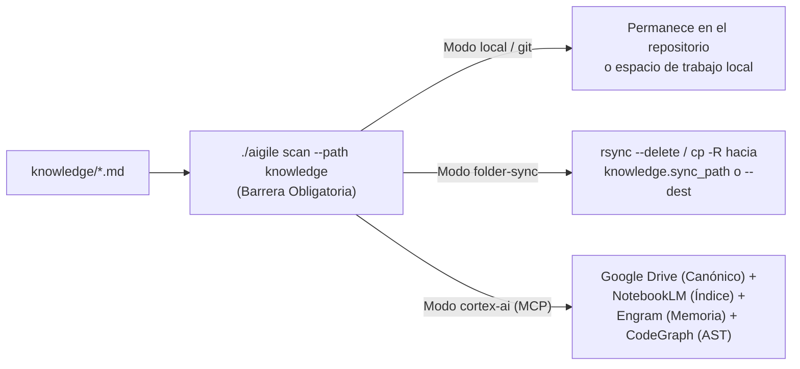

# Gobernanza de Seguridad, Datos y Sincronización de Conocimiento

> **Volver al Portal:** [`docs/es/index.md`](../index.md) | **English:** [`docs/en/governance/security-and-knowledge-sync.md`](../../en/governance/security-and-knowledge-sync.md)

Este manual describe los controles técnicos de seguridad, privacidad de datos, persistencia e indexación y sincronización documental en **`aigile-forge-framework`**, respaldados por `scripts/aff-secret-scan.sh`, `scripts/aff-knowledge-sync.sh`, `skills/security-compliance-audit/SKILL.md` y `skills/db-cache-guardrails/SKILL.md`.

---

## 1. Escáner Preventivo de Secretos (`scripts/aff-secret-scan.sh`)

El comando `./aigile scan` actúa como barrera determinista antes de confirmar cambios en Git o sincronizar documentos de conocimiento hacia carpetas externas o servidores MCP.

### 1.1 Reglas de Detección Incorporadas

| Código de Regla | Patrón Auditado | Riesgo Mitigado |
|---|---|---|
| `PRIVATE_KEY` | Bloques `BEGIN ... PRIVATE KEY` (RSA, EC, OPENSSH, PGP, PKCS8) | Exposición irreversible de llaves criptográficas o certificados TLS/SSH. |
| `AWS_ACCESS_KEY` | Identificadores `\bAKIA[0-9A-Z]{16}\b` | Compromiso de cuentas y recursos de infraestructura en AWS. |
| `GITHUB_TOKEN` | Tokens personales o de aplicación `\bgh[pousr]_[A-Za-z0-9_]{12,}\b` | Acceso no autorizado a código fuente, paquetes y pipelines CI/CD. |
| `GOOGLE_API_KEY` | Claves `\bAIza[0-9A-Za-z_-]{16,}\b` | Consumo fraudulento o fuga en servicios Google Cloud / Firebase / Gemini. |
| `SLACK_TOKEN` | Tokens `\bxox[baprs]-[0-9A-Za-z-]{10,}\b` | Exfiltración de canales corporativos y automatizaciones internas. |
| `HARDCODED_SECRET` | Asignaciones literales (`password`, `secret`, `api_key`, `access_token`, `client_secret`, `private_key`) `>= 8` caracteres | Credenciales incrustadas en código, configuraciones o pruebas. |
| `RAW_CARD_PAN` | Secuencias numéricas sin enmascarar de 16 dígitos compatibles con PAN de pago | Incumplimiento grave de estándares PCI-DSS en código, fixtures o documentación. |

### 1.2 Exclusiones Inteligentes y Supresión Auditada
- **Directorios ignorados automáticamente en modo `--path`:** `.git`, `node_modules`, `target`, `build`, `dist`, `.venv`, `venv`, `__pycache__`, `.gradle`, `.idea`, enlaces simbólicos y archivos binarios.
- **Valores sintéticos permitidos:** En `HARDCODED_SECRET`, el motor en Python 3 ignora marcadores inocuos como `changeme`, `placeholder`, `your-api-key`, `redacted`, `********` o prefijos `example`, `dummy`, `sample`, `mock_`, además de referencias a variables `${ENV_VAR}`.
- **Marca de excepción explícita en falsos positivos de prueba:** Si una prueba unitaria legítima necesita un identificador sintético que dispara una expresión regular, añada el comentario en línea `# aff-secret-scan:ignore` (o `// aff-secret-scan:ignore`), el cual será auditado durante la revisión 4R (`G3`).

### 1.3 Modos de Ejecución e Instalación del Hook `pre-commit`
```bash
# 1. Escanear líneas añadidas en el índice de Git (modo predeterminado --staged)
./aigile scan

# 2. Escanear un directorio o archivo completo (por ejemplo, work/ o knowledge/)
./aigile scan --path work/PAG-104

# 3. Instalar el bloqueo automático en .git/hooks/pre-commit
./aigile scan --install-hook
```

---

## 2. Protección de Datos Regulados (PII, PHI, PCI y Secretos)

En `aff.yaml`, la lista `guardrails.redact_patterns` (`["secrets", "pii", "pci", "phi"]`) instruye a todos los agentes del framework a aplicar **sanitización en el origen**:

1. **Prohibición en artefactos y prompts:** Jamás pegue ni persista documentos nacionales de identidad reales, correos o teléfonos de clientes reales, historias clínicas/diagnósticos protegidos (`PHI`), números completos de tarjeta (`PAN`/`CVV`) ni tokens productivos dentro de `work/`, `knowledge/`, `odd/tasks/` o suites de prueba.
2. **Marcadores sintéticos obligatorios:** Durante `/aff-intake` e `/incident-rca-debugging`, reemplace cualquier valor sensible por marcadores explícitos:
   - `<REDACTED:token>`, `<REDACTED:secret>`
   - `<REDACTED:id>`, `<REDACTED:email>`, `<REDACTED:phone>`
   - `<REDACTED:pan>`, `<REDACTED:health-record>`
3. **Registros de aplicación (Logging) y Almacenamiento en Cliente:**
   - Los perfiles `backend-*` prohíben volcar cuerpos crudos de peticiones autenticadas o cabeceras `Authorization` / `Cookie` en los logs.
   - En clientes Web y Móvil (`frontend-web`, `mobile-native`), los tokens de sesión nunca deben guardarse en `localStorage` ni preferencias en texto plano; utilice cookies `HttpOnly; Secure; SameSite` en Web, `Android Keystore` / `EncryptedSharedPreferences` en Android y `Keychain Services` en iOS.

---

## 3. Gobernanza de Base de Datos y Caché Distribuida

Configurada en `aff.yaml` bajo `guardrails` y exigida en las compuertas `G2` y `G3`:

### 3.1 Índices Transaccionales y Migraciones Seguras (`require_db_indexes: true`)
- **Cero predicados sin índice:** Toda consulta SQL (`WHERE`, `JOIN`, `ORDER BY`) o filtro NoSQL introducido por una funcionalidad debe respaldarse con un índice existente o declarado en la migración asociada.
- **Validación de planes de ejecución:** En tablas de alto volumen, verifique el plan (`EXPLAIN` / `EXPLAIN ANALYZE`) y utilice paginación acotada (por cursor o límite estricto), prohibiendo lecturas sin cota y patrones N+1.
- **Migraciones compatibles N/N-1 (Expand-and-Contract):** Nunca renombre ni elimine una columna en el mismo despliegue en que la versión anterior `N-1` del servicio sigue leyendo de ella; agregue primero la estructura compatible, migre lecturas/escrituras y retire lo obsoleto en un cambio posterior.

### 3.2 Claves Jerárquicas y TTL Finito en Caché (`require_cache_ttl: true`)
Toda entrada en Redis, Valkey, Memcached o cachés distribuidas debe cumplir tres invariantes:
1. **Patrón obligatorio de clave (`guardrails.cache_key_pattern`):**
   ```text
   {namespace}:{domain}:{service}:{entity}:{id}
   ```
   *Ejemplo válido:* `comercio:pagos:orders-service:summary:ord_98231` (evita colisiones entre servicios que comparten clúster y facilita invalidación selectiva).
2. **TTL finito explícito:** Quedan prohibidas las escrituras perpetuas sin expiración (`SET` sin `EX`/`PX`), previniendo agotamiento de memoria y datos obsoletos permanentes.
3. **Cero PII/PCI/PHI en texto plano:** No almacene datos personales sensibles ni credenciales sin cifrar dentro de valores de caché compartida.

---

## 4. Sincronización de Conocimiento (`local`, `folder-sync` y `cortex-ai`)

El script `scripts/aff-knowledge-sync.sh` (invocado mediante `./aigile sync`) gestiona la publicación segura de `knowledge/` soportando tres arquitecturas de almacenamiento. **Importante:** antes de ejecutar cualquier sincronización (`--sync`), el script dispara automáticamente `./aigile scan --path knowledge` y aborta si detecta algún patrón sensible.



### 4.1 Modo `local` (y alias `git` — Predeterminado)
- Mantiene `knowledge/` únicamente dentro del árbol del espacio de trabajo local (versionado junto con el repositorio o en el Hub `multi-root`).
- Ideal para equipos que centralizan toda su arquitectura y ADRs en Git sin dependencias externas:
  ```bash
  ./aigile sync --status
  ```

### 4.2 Modo `folder-sync` (y alias `cloud-folder` — Sin MCP)
- Diseñado para entornos corporativos en modo `zero-mcp` que comparten documentación mediante unidades de red montadas, carpetas sincronizadas por el cliente corporativo de escritorio o volúmenes NFS/SMB.
- Utiliza `rsync -a --delete` (o `cp -R` limpio como respaldo) y escribe la marca UTC en `<destino>/.last-sync-timestamp`:
  ```bash
  # Previsualizar sin modificar archivos (--dry-run)
  ./aigile sync --sync --mode folder-sync --dest /mnt/arquitectura/proyecto-pagos --dry-run

  # Ejecutar sincronización real (tras aprobar automáticamente el escaneo de secretos)
  ./aigile sync --sync --mode folder-sync --dest /mnt/arquitectura/proyecto-pagos
  ```
  También puede fijar la ruta en `aff.yaml` (`knowledge.mode: "folder-sync"` y `knowledge.sync_path: "/mnt/arquitectura/proyecto-pagos"`) o mediante la variable `AFF_KNOWLEDGE_SYNC_DEST`.

### 4.3 Modo `cortex-ai` (Segundo Cerebro Conectado vía MCP)
Activo cuando `harnesses.mode: "mcp"` y `knowledge.mode: "cortex-ai"`. Combina cuatro herramientas MCP complementarias con responsabilidades estrictamente separadas para evitar duplicación:
1. **Google Drive (`mcp/google-drive.json`):** Almacén documental canónico compartido para especificaciones aprobadas, mapas de arquitectura y ADRs (`${DRIVE_ROOT_FOLDER_ID}`).
2. **NotebookLM (`mcp/notebooklm.json`):** Índice semántico derivado sobre los documentos curados para consultas fundamentadas con citas exactas (`${NOTEBOOKLM_NOTEBOOK_ID}`).
3. **Engram (`mcp/engram.json`):** Memoria estructurada persistente entre sesiones para decisiones tácticas, descubrimientos y contexto incremental (`${ENGRAM_PROJECT}`).
4. **CodeGraph (`mcp/codegraph.json`):** Grafo AST del código fuente para análisis de impacto entre símbolos y dependencias (`${CODEGRAPH_WORKSPACE}`).

Para consultar el estado o recibir la guía interactiva de sincronización en modo `cortex-ai`:
```bash
./aigile sync --status --mode cortex-ai
./aigile sync --sync --mode cortex-ai
```
