# Manual Operativo del Desarrollador (Flujos de Trabajo Día a Día)

> **Volver al Portal:** [`docs/es/index.md`](../index.md) | **English:** [`docs/en/guides/developer-workflow-manual.md`](../../en/guides/developer-workflow-manual.md)

Este manual es la guía práctica de uso diario para desarrolladores que trabajan con **`aigile-forge-framework`**. Explica primero cómo invocar agentes, habilidades (`skills`) y comandos slash en cada uno de los **5 harnesses soportados**, y luego recorre paso a paso los **cuatro flujos operativos reales** más frecuentes en ingeniería de software.

---

## 1. Cómo Operar en Cada Uno de los 5 Harnesses

Antes de comenzar su jornada o tras actualizar `aff.yaml`, verifique que su proyección local esté sincronizada:

```bash
./aigile harness sync all
./aigile doctor
```

A continuación se detalla cómo activar los mismos contratos, agentes y prompts en cada herramienta:

### 1.1 Claude Code (`claude`)
- **Carga automática de reglas:** Al iniciar `claude` en la raíz del espacio de trabajo, lee `CLAUDE.md`, que importa `@AGENTS.md`.
- **Invocación de subagentes por rol:** Los 10 agentes están proyectados en `.claude/agents/*.md`. Pida explícitamente delegar en un agente o abrir una sesión limpia para auditoría:
  ```text
  Usa el agente pm (.claude/agents/pm.md) y ejecuta prompts/elicit-ticket.prompt.md para el ticket PAG-104.
  ```
- **Uso de habilidades (`skills`):** Proyectadas en `.claude/skills/<skill>/SKILL.md`. Se cargan automáticamente por contexto o citando la ruta.
- **Sesión limpia para Gate `G3`:** Ejecute `/clear` en Claude Code (o abra otra terminal con `claude`) antes de lanzar `/review-4r` para evitar sesgo de confirmación del autor.

### 1.2 OpenCode (`opencode`)
- **Carga automática de reglas:** Lee `AGENTS.md` y `opencode.json` en la raíz del proyecto.
- **Cambio de agente activo:** OpenCode descubre automáticamente `.opencode/agents/*.md` y `.agents/agents/*.md` (`onboarding`, `orchestrator`, `pm`, `analyst`, `architect`, `security`, `qa`, `curator`, `delivery`, `reviewer`).
- **Ejecución de prompts slash:** Referencie directamente el archivo en `prompts/`:
  ```text
  Actúa como el agente architect y ejecuta @prompts/contract-first.prompt.md sobre work/PAG-104/spec.md
  ```

### 1.3 Google Antigravity (`antigravity`)
- **Carga automática de reglas:** Lee `AGENTS.md` en la raíz y descubre `.agents/skills/*/SKILL.md` y `.agents/agents/*.md` (más `.agents/mcp_config.json` si `harnesses.mode: "mcp"`).
- **Ejecución de flujos:** Invoque cualquier flujo indicando el prompt canónico y el ticket:
  ```text
  Ejecuta prompts/work-units.prompt.md para el ticket PAG-104 cargando skills/odd-workflow/SKILL.md y skills/work-unit-tdd/SKILL.md.
  ```
- **Delegación de revisión:** En Mission Control o mediante subagentes acotados, asigne `agents/reviewer.md` sobre un contexto limpio para la auditoría 4R.

### 1.4 OpenAI Codex (`codex`)
- **Carga automática de reglas:** `codex` carga nativamente `AGENTS.md` al abrir el directorio de trabajo y accede a `.agents/skills/` y `.agents/agents/`.
- **Invocación desde terminal o sesión interactiva:**
  ```bash
  codex "Carga agents/delivery.md y ejecuta la unidad T1 de odd/tasks/pag-104-reembolsos-parciales.md siguiendo TDD estricto"
  ```

### 1.5 GitHub Copilot en VS Code (`copilot`)
- **Instrucciones globales y por archivo:** VS Code carga automáticamente `.github/copilot-instructions.md` en cada chat y activa dinámicamente `.github/instructions/<perfil>.instructions.md` según la extensión del archivo abierto (`applyTo`).
- **Selector de Agentes Personalizados:** En el panel de Copilot Chat (modo Agent), despliegue el selector de agentes y elija cualquiera de los 10 roles con prefijo `aff-`:
  - `@aff-onboarding`, `@aff-orchestrator`, `@aff-pm`, `@aff-analyst`, `@aff-architect`, `@aff-security`, `@aff-qa`, `@aff-curator`, `@aff-delivery`, `@aff-reviewer`.
- **Comandos Slash Nativos (`.github/prompts/*.prompt.md`):** Escriba `/` en Copilot Chat para autocompletar e invocar directamente:
  - `/init-team`, `/aff-intake`, `/elicit-ticket`, `/answers-to-spec`, `/contract-first`, `/parity-check`, `/work-units`, `/review-4r`, `/review-refuter`.
- **Sesión limpia en Copilot:** Haga clic en el botón **New Chat (`+`)**, seleccione `aff-reviewer` y ejecute `/review-4r` seguido de `/review-refuter`.

---

## 2. Flujo 1: Funcionalidad Completa de Punta a Punta (Ticket Ambiguo -> Pull Request)

**Escenario:** Recibe en el backlog el ticket `PAG-104` con una descripción escueta: *"Permitir reembolsos parciales desde el panel de operaciones"*. Afecta al servicio backend y a la aplicación web (tamaño `M`).

```mermaid
flowchart LR
    T0["Ticket Crudo<br/>PAG-104"] --> S1["session start +<br/>worktree create"]
    S1 --> P1["/aff-intake<br/>(orchestrator)"]
    P1 --> P2["/elicit-ticket<br/>(pm)"]
    P2 --> P3["/answers-to-spec<br/>(analyst) -> G1"]
    P3 --> P4["/contract-first<br/>(architect) -> G2"]
    P4 --> P5["/work-units + TDD<br/>(delivery <=400 LoC)"]
    P5 --> P6["/review-4r + /review-refuter<br/>(reviewer limpio) -> G3"]
    P6 --> P7["receipt generate + PR<br/>(qa / delivery) -> G4"]
```



### Paso 1: Iniciar Sesión y Aislar Árbol de Trabajo
Desde la raíz del espacio de trabajo:
```bash
./aigile session start PAG-104
./aigile worktree create PAG-104
```
Esto crea la bitácora activa `work/sessions/SES-<UTC>.md`, la carpeta `work/PAG-104/evidence/` y los árboles Git aislados en `worktrees/PAG-104/<repo>/` sobre la rama `feat/PAG-104`.

### Paso 2: Recepción, Sanitización y Triaje (`/aff-intake`)
En su harness, invoque **`/aff-intake`** pasando el identificador `PAG-104` y el texto original del ticket:
- El agente `orchestrator` limpia cualquier identificador sensible (`<REDACTED:...>`) y escribe `work/PAG-104/ticket-in.md`.
- Clasifica el tamaño como **`M`** e inicializa `work/PAG-104/state.yaml` en `phase: 1`.

### Paso 3: Elicitación de Hipótesis y Estimación PERT (`/elicit-ticket`)
Invoque **`/elicit-ticket`** para `PAG-104`:
- El agente `pm` formula hipótesis de negocio y redacta **hasta 10 preguntas bloqueantes `P1`**, cada una acompañada de una **Opción Recomendada por Defecto** (por ejemplo: moneda del reembolso, límite acumulado igual al total capturado, clave de idempotencia obligatoria, permisos RBAC).
- Calcula la estimación PERT de 3 puntos ($E = (O + 4M + P)/6$) ajustada por `focus_factor` y guarda todo en `work/PAG-104/elicitation.md`.
- Valide las respuestas con Producto o confirme las opciones recomendadas directamente en `work/PAG-104/elicitation.md`.

### Paso 4: Especificación Gherkin y Compuerta `G1` (`/answers-to-spec`)
Invoque **`/answers-to-spec`** sobre `PAG-104`:
- El agente `analyst` transforma las respuestas confirmadas en criterios numerados `AC-1`, `AC-2`, `AC-3` en formato *Given / When / Then* dentro de `work/PAG-104/spec.md`.
- Genera los cortes por repositorio en `work/PAG-104/slices/` y prepara `work/PAG-104/gate-record.md`.
- **Aprobación Humana `G1`:** El Líder Técnico (y el Product Owner si `dual_po_approval: true`) revisa `spec.md`. Una vez aprobado, se registra el hash SHA256 de `spec.md` en `work/PAG-104/state.yaml` (`gates.G1.approved: true`).

### Paso 5: Diseño Guiado por Contratos y Compuerta `G2` (`/contract-first`)
Invoque **`/contract-first`** para `PAG-104`:
- El agente `architect` diseña `work/PAG-104/contract.md`: endpoint `POST /v1/payments/{id}/refunds`, cabecera `Idempotency-Key`, payloads sintéticos sanitizados, taxonomía de errores (`ERR_REFUND_EXCEEDS_CAPTURED`), compatibilidad N/N-1, índice compuesto en la tabla `refunds(payment_id, created_at)` y clave de caché `{namespace}:payments:ledger:summary:{id}` con TTL explícito de `300s`.
- **Aprobación Humana `G2`:** Revisado el contrato, se congela su firma SHA256 en `state.yaml` (`gates.G2.approved: true`).

### Paso 6: Descomposición en Unidades Atómicas y Ejecución TDD (`/work-units`)
Invoque **`/work-units`** con el agente `delivery`:
- Crea `odd/tasks/pag-104-partial-refunds.md` dividiendo el trabajo en unidades cohesivas `T1`, `T2`, `T3`, cada una **`<= 400` líneas de código** con comando de prueba explícito.
- Para cada unidad `T#`, el sub-rol `implementer` aplica **Red-Green-Refactor**:
  1. **RED:** Escribe la prueba automatizada que falla validando `AC-#`.
  2. **GREEN:** Escribe la implementación mínima respetando los perfiles activos (`profiles/*.md`).
  3. **REFACTOR + SCAN + COMMIT:** Refactoriza sin romper pruebas, ejecuta `./aigile scan` y crea un Conventional Commit limpio en inglés dentro de `worktrees/PAG-104/<repo>/` (sin `Co-Authored-By`).

### Paso 7: Auditoría 4R en Sesión Limpia y Compuerta `G3` (`/review-4r` + `/review-refuter`)
Abra una **sesión limpia** de su harness (sin el historial de codificación previo) y seleccione el agente `reviewer`:
1. Ejecute **`/review-4r`** (Pasada 1 — Auditor Crítico): inspecciona el diff frente a `spec.md` y `contract.md` en **Risk, Requirements, Regression y Resilience**, escribiendo los hallazgos candidatos en `work/PAG-104/review-4r.md`.
2. Ejecute **`/review-refuter`** (Pasada 2 — Refutador Adversarial): contrasta cada hallazgo con el resto del repositorio para descartar falsos positivos con evidencia `archivo:línea` (`REFUTED`) y mantener únicamente defectos reales (`SUSTAINED`).
3. Si existen hallazgos `CRITICAL` o `HIGH` sostenidos, corríjalos y repita. Cuando el veredicto sea `APPROVED FOR GATE G3`, selle el recibo de revisión:
   ```bash
   ./aigile receipt generate PAG-104 G3 -- ./aigile scan --path worktrees/PAG-104
   ```

### Paso 8: Recibo de Entrega `G4`, Documentación de PR y Cierre
Ejecute la batería completa de pruebas dentro de un recibo criptográfico `G4`:
```bash
./aigile receipt generate PAG-104 G4 -- bash -c "cd worktrees/PAG-104/payments-api && ./mvnw verify"
./aigile receipt verify work/PAG-104/evidence/receipt-G4.json
```
Finalmente:
- Genere la descripción trazable del Pull Request (`work/PAG-104/pr.md`) mediante la habilidad `pull-request-documentation`.
- Publique la rama `feat/PAG-104`, abra el Pull Request y, tras fusionar, cierre la sesión y limpie el worktree:
  ```bash
  ./aigile session close "PAG-104 entregado con recibos G3/G4 verificados"
  ./aigile worktree remove PAG-104
  ```

---

## 3. Flujo 2: Interrupción Urgente sin `git stash` (Cambio de Contexto en `< 30s`)

**Escenario:** Está a mitad de la unidad `T2` en `PAG-104` con archivos modificados y recibe el aviso de atender de inmediato una consulta o bloqueo urgente en otro ticket `PAG-119`. Recuerde la regla inquebrantable de `aff.yaml`: **`ban_git_stash: true`**.

### Paso 1: Congelar el Estado en Vuelo (`< 30` segundos)
```bash
# 1. Crear un commit de punto de control en todos los worktrees de PAG-104
./aigile worktree checkpoint PAG-104 "wip(PAG-104): validacion de monto acumulado en T2"

# 2. Registrar en la bitácora de sesión el paso exacto para retomar en frío
./aigile session checkpoint "Pausado en T2 (RefundValidatorTest en verde; falta endpoint REST). Motivo: urgencia PAG-119"
./aigile session close "Pausa controlada para atender PAG-119"
```

### Paso 2: Atender el Nuevo Requerimiento en un Árbol Paralelo Limpio
Sin tocar ni deshacer nada de `worktrees/PAG-104/`:
```bash
./aigile session start PAG-119
./aigile worktree create PAG-119
```
Trabaje en `worktrees/PAG-119/`, entregue la solución y cierre la sesión de `PAG-119`.

### Paso 3: Retomar `PAG-104` en Frío (Incluso desde Otro Harness o al Día Siguiente)
```bash
./aigile session resume PAG-104
./aigile worktree list
```
`./aigile session resume PAG-104` imprime en pantalla todo el historial de puntos de control, reactiva la bitácora como `ACTIVE` y le permite a cualquier harness continuar exactamente en el punto donde se detuvo, sin conflictos de `stash pop` ni pérdida de contexto.

---

## 4. Flujo 3: Incidente o Hotfix en Producción (Tamaño `H`)

**Escenario:** Se detecta en producción un error `500` intermitente al procesar confirmaciones duplicadas de webhook (`INC-902`). Se requiere mitigación quirúrgica segura y trazable.

### Paso 1: Aislamiento Inmediato y Triaje `H`
```bash
./aigile session start INC-902
./aigile worktree create INC-902
```
Ejecute **`/aff-intake`** con `INC-902`: el agente `orchestrator` asigna `size_class: "H"` y activa la ruta rápida controlada por la habilidad **`skills/incident-rca-debugging/SKILL.md`**.

### Paso 2: Diagnóstico Determinista de Causa Raíz (RCA)
Con el agente `delivery` (sub-rol de solo lectura `code-analyzer`):
1. Rastree la petición fallida mediante `X-Correlation-Id` / `traceparent` (redactando cualquier dato real de clientes antes de guardar notas en `work/INC-902/rca.md`).
2. Formule hipótesis falsables y descártelas con evidencia del código fuente (por ejemplo: condición de carrera por ausencia de restricción única e idempotencia al insertar el evento).
3. Documente la causa raíz confirmada y el radio de impacto en `work/INC-902/rca.md`.

### Paso 3: Prueba de Reproducción en Rojo y Corrección Quirúrgica
1. **RED obligatorio:** Antes de tocar el código productivo, escriba una prueba automatizada en `worktrees/INC-902/<repo>/` que reproduzca exactamente la falla concurrente o de entrada y verifique que falle.
2. **GREEN quirúrgico:** Aplique el cambio mínimo necesario para corregir el defecto sin mezclar refactorizaciones cosméticas.
3. Verifique que toda la suite pase y ejecute `./aigile scan`.

### Paso 4: Revisión 4R Acelerada, Recibos `G3`/`G4` y Postmortem
Los hotfixes **nunca omiten `G3` ni `G4`** (un parche apresurado sin revisión es la causa principal de incidentes secundarios):
1. En sesión limpia, ejecute `/review-4r` y `/review-refuter` verificando especialmente **Regression** y **Resilience** (idempotencia, timeouts y reversión).
2. Genere los recibos firmados:
   ```bash
   ./aigile receipt generate INC-902 G3 -- ./aigile scan --path worktrees/INC-902
   ./aigile receipt generate INC-902 G4 -- bash -c "cd worktrees/INC-902/payments-api && ./mvnw test"
   ```
3. Tras desplegar la mitigación, invoque al agente `curator` (dentro de las 24 horas posteriores) para consolidar las lecciones arquitectónicas en `knowledge/` mediante `knowledge-checkpoint-curation`.

---

## 5. Flujo 4: Cambio Multirrepositorio y Paridad 1:1 Web / Móvil (Tamaño `L`)

**Escenario:** El ticket `COM-510` introduce autenticación reforzada de operaciones de alto monto en tres repositorios: `orders-service` (Backend), `storefront-web` (Web) y `storefront-mobile` (Android Kotlin + iOS Swift), con `governance.multi_channel_parity: true` en `aff.yaml`.

### Paso 1: Triaje `L`, Elicitación y Especificación Multicanal (`G1`)
1. Inicie sesión y worktrees para los tres repositorios:
   ```bash
   ./aigile session start COM-510
   ./aigile worktree create COM-510 repositories/orders-service repositories/storefront-web repositories/storefront-mobile
   ```
2. Complete `/aff-intake` (`size_class: "L"`), `/elicit-ticket` y `/answers-to-spec`.
3. `analyst` genera `work/COM-510/spec.md` y tres archivos de corte en `work/COM-510/slices/`:
   - `slices/orders-service.md` (productor del contrato)
   - `slices/storefront-web.md` (consumidor Web)
   - `slices/storefront-mobile.md` (consumidor Android/iOS)
4. Obtenga la aprobación humana **`G1`**.

### Paso 2: Contrato Primero y Auditoría `/parity-check` (`G2`)
1. Ejecute **`/contract-first`** con `architect` para congelar esquemas JSON, cabeceras, compatibilidad N/N-1 (clientes móviles antiguos siguen operando mientras actualizan versión en tiendas) y códigos de error `ERR_*` en `work/COM-510/contract.md`.
2. Ejecute **`/parity-check`** (`prompts/parity-check.prompt.md` + `skills/multi-channel-parity/SKILL.md`):
   - Verifica que **ninguna regla de negocio, cálculo de umbrales ni autorización** resida exclusivamente en Web, Android o iOS.
   - Construye la matriz 1:1 de campos, validaciones, anulabilidad, tolerancia a valores de enumeración desconocidos (`UNKNOWN`) y mapeo de errores entre Web, Android e iOS.
   - Valida almacenamiento seguro por plataforma (`EncryptedSharedPreferences`/Keystore en Android, `Keychain Services` en iOS y cookies `HttpOnly` o memoria efímera en Web).
3. Aprobada la compuerta **`G2`**, los desarrolladores de Backend, Web y Móvil implementan sus unidades `/work-units` en paralelo contra el contrato congelado.

### Paso 3: Verificación Cruzada antes de `G3` y `G4`
Antes de aprobar `G3`, vuelva a ejecutar `/parity-check` sobre el código implementado en los tres worktrees junto con `/review-4r` + `/review-refuter`, emita un recibo SHA256 de pruebas por cada repositorio impactado y coordine el orden de despliegue (primero Backend compatible N/N-1, luego Web y publicación móvil).
