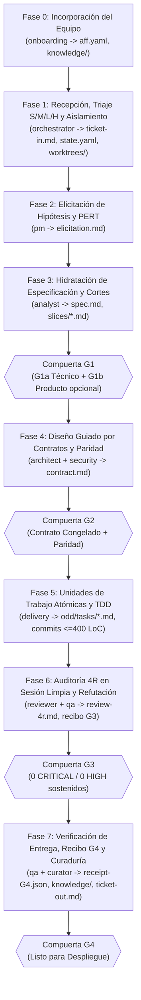

# Ciclo de Vida de 8 Fases, Compuertas (`G1`–`G4`), Revisión 4R y Recibos RDD

> **Volver al Portal:** [`docs/es/index.md`](../index.md) | **English:** [`docs/en/guides/lifecycle-gates-and-4r.md`](../../en/guides/lifecycle-gates-and-4r.md)

Este manual constituye la referencia normativa del modelo de gobernanza de **`aigile-forge-framework`**: las **8 fases operativas (Fases 0 a 7)**, la matriz de ceremonia proporcional **`S / M / L / H`**, las listas de verificación de las compuertas humanas **`G1`–`G4`**, el protocolo determinista de **revisión adversarial 4R de dos pasadas** y la estructura criptográfica de los **recibos SHA256 (Receipt-Driven Development)**.

---

## 1. Referencia Completa del Ciclo de Vida de 8 Fases (Fases 0–7)

Cada fase define un agente responsable principal, artefactos de entrada y salida verificables y un criterio estricto de avance registrado en `work/<TICKET-ID>/state.yaml`:



### Tabla Detallada de Fases 0 a 7

| Fase | Nombre | Agente Líder | Entradas | Salidas Canónicas | Criterio de Salida |
|---|---|---|---|---|---|
| **Fase 0** | **Incorporación del Equipo y Espacio de Trabajo** | `onboarding` | Contexto del equipo y repositorios | `aff.yaml`, `knowledge/*.md`, proyecciones de harnesses | `./aigile doctor` y `./aigile harness check` retornan código `0` (una vez por proyecto o cambio mayor). |
| **Fase 1** | **Recepción, Triaje y Aislamiento** | `orchestrator` | Descripción cruda del ticket | `work/<ID>/ticket-in.md`, `state.yaml`, `worktrees/<ID>/`, sesión activa | Datos sensibles redactados (`<REDACTED:...>`) y tamaño `S/M/L/H` clasificado. |
| **Fase 2** | **Elicitación de Hipótesis y Estimación PERT** | `pm` | `ticket-in.md`, `knowledge/domain*` | `work/<ID>/elicitation.md` (`<= 10` preguntas `P1` con valores por defecto + PERT) | Preguntas `P1` respondidas por los interesados o valores recomendados confirmados. |
| **Fase 3** | **Hidratación Funcional y Corte de Repositorios** | `analyst` | `elicitation.md` resuelto | `work/<ID>/spec.md` (Given/When/Then `AC-#`), `work/<ID>/slices/*.md`, `gate-record.md` | **Compuerta `G1`** aprobada y `artifact_sha256` de `spec.md` sellado en `state.yaml`. |
| **Fase 4** | **Diseño de Contratos Primero y Paridad** | `architect`, `security` | `spec.md`, `knowledge/architecture*` | `work/<ID>/contract.md` (OpenAPI/AsyncAPI, errores, N/N-1, índices BD, claves TTL, paridad) | **Compuerta `G2`** aprobada y `contract_sha256` registrado en `state.yaml`. |
| **Fase 5** | **Planificación Atómica y Ejecución TDD** | `delivery` | `spec.md`, `contract.md`, `profiles/*.md` | `odd/tasks/<id>-<slug>.md`, código productivo + pruebas automatizadas | Todas las unidades `T#` (`<= 400` LoC) en verde mediante Red-Green-Refactor y `./aigile scan` limpio. |
| **Fase 6** | **Auditoría 4R en Sesión Limpia y Refutación** | `reviewer`, `qa` | Diff Git, `spec.md`, `contract.md` | `work/<ID>/review-4r.md` (Pasadas 1 y 2), `work/<ID>/pr.md`, `evidence/receipt-G3.json` | **Compuerta `G3`** aprobada con `0` hallazgos `CRITICAL` y `0` hallazgos `HIGH` sostenidos. |
| **Fase 7** | **Verificación de Entrega, Recibo RDD y Curaduría** | `qa`, `curator`, `orchestrator` | Rama validada, `review-4r.md` | `work/<ID>/evidence/receipt-G4.json`, `ticket-out.md`, actualización de `knowledge/` y ADRs | **Compuerta `G4`** verificada criptográficamente, PR listo/fusionado y sesión cerrada. |

---

## 2. Matriz de Dimensionamiento Proporcional (`S / M / L / H`)

El rigor documental se escala estrictamente según el riesgo y el radio de impacto técnico, evitando burocracia innecesaria en cambios pequeños:

| Dimensión | `S` (Pequeño) | `M` (Mediano) | `L` (Grande / Multicanal) | `H` (Incidente / Hotfix) |
|---|---|---|---|---|
| **Alcance típico** | Ajuste puntual o corrección `<= 150` líneas en 1 repositorio, sin cambio de API ni esquema BD. | Funcionalidad estándar en 1 o 2 repositorios (~150–400+ líneas). | Cambio multirrepositorio, migración de base de datos o impacto Web + Móvil. | Falla crítica o degradación activa en producción. |
| **Elicitación (`elicitation.md`)** | Omitida si el ticket es inequívoco. | Recomendada (`<= 10` preguntas `P1` + PERT). | Obligatoria con estimación PERT y colchón de riesgo. | Sustituida por diagnóstico `work/<ID>/rca.md` (`incident-rca-debugging`). |
| **Especificación y `G1`** | `spec.md` conciso + `G1` ágil. | `spec.md` completo (`AC-#`) + `G1` (`G1a`/`G1b`). | `spec.md` + `slices/*.md` por repositorio + `G1` formal. | Criterio de mitigación y prueba de reproducción en rojo. |
| **Contrato y `G2`** | **Omitida** (cero impacto en interfaces o datos). | Exigida si modifica endpoints, eventos o tablas. | **Obligatoria** (`contract.md` + plan N/N-1 + `/parity-check`). | Exigida solo si altera esquemas de emergencia. |
| **Unidades ODD + TDD** | Ejecución directa TDD en 1 unidad `T1`. | Unidades `T1..Tn` (`<= 400` LoC) en `odd/tasks/`. | Unidades por repositorio en `worktrees/<ID>/<repo>/`. | Prueba en rojo que reproduce el fallo + parche quirúrgico mínimo. |
| **Auditoría 4R (`G3`) y Recibo (`G4`)** | **Obligatorios** (`review-4r.md` + recibos SHA256). | **Obligatorios**. | **Obligatorios** en cada repositorio afectado. | **Obligatorios** antes de desplegar + curaduría RCA en `< 24h`. |

---

## 3. Listas de Verificación de Compuertas Humanas (`G1`–`G4`)

Ningún agente está autorizado a autoaprobar una compuerta humana ni a continuar si un artefacto aprobado cambia su hash SHA256 con posterioridad a la firma registrada en `state.yaml`.

### Compuerta `G1` — Definición de Listo (y Modo Dual `G1a` / `G1b`)
- [ ] Cero preguntas bloqueantes `P1` sin respuesta en `work/<ID>/elicitation.md`.
- [ ] Todos los criterios de aceptación `AC-#` en `work/<ID>/spec.md` están expresados en formato verificable *Given / When / Then*, incluyendo casos de error y bordes.
- [ ] Los límites fuera de alcance (*Non-Goals*) y requisitos no funcionales están explícitos.
- [ ] **Modo `dual_po_approval: true` en `aff.yaml`:** `G1` se divide en **`G1a`** (firma de factibilidad y alcance técnico por `team.lead_role`) y **`G1b`** (firma funcional y de negocio por el Product Owner, con referencia `tracker_ref`).

### Compuerta `G2` — Contrato Congelado, Datos y Paridad
- [ ] Esquemas de petición/respuesta REST, GraphQL o eventos AsyncAPI definidos sin ambigüedad en `work/<ID>/contract.md` con ejemplos sintéticos sanitizados.
- [ ] Estrategia de compatibilidad hacia atrás **N / N-1** documentada (expansión antes de contracción en base de datos y APIs).
- [ ] Cada predicado `WHERE` / `JOIN` / `ORDER BY` nuevo cuenta con índice declarado (`guardrails.require_db_indexes: true`).
- [ ] Toda clave de caché respeta `{namespace}:{domain}:{service}:{entity}:{id}` y define un TTL finito.
- [ ] Si `governance.multi_channel_parity: true`, `/parity-check` certifica correspondencia 1:1 entre Web, Android e iOS.

### Compuerta `G3` — Auditoría Adversarial 4R en Sesión Limpia y Seguridad
- [ ] Las dos pasadas (`/review-4r` y `/review-refuter`) fueron ejecutadas en una sesión limpia independiente del contexto de implementación.
- [ ] Recuento de hallazgos sostenidos de severidad `CRITICAL == 0` y `HIGH == 0` en `work/<ID>/review-4r.md`.
- [ ] `./aigile scan` pasa con `0` hallazgos de secretos, tokens o PANs.
- [ ] Ningún commit contiene atribución de IA (`Co-Authored-By`) y cada unidad respeta el diseño aprobado en `G1`/`G2`.

### Compuerta `G4` — Preparación de Entrega y Sello Criptográfico RDD
- [ ] Recibo `work/<ID>/evidence/receipt-G4.json` generado ejecutando la suite real de pruebas y compilación con `exit_code: 0`.
- [ ] `./aigile receipt verify work/<ID>/evidence/receipt-G4.json --verify-head` retorna `VERIFY OK`.
- [ ] Paquete de Pull Request (`work/<ID>/pr.md`) incluye tabla de trazabilidad `AC-# -> prueba`, plan de despliegue y procedimiento de reversión (*rollback*).
- [ ] Documentación duradera en `knowledge/` y reporte `ticket-out.md` actualizados.

---

## 4. Protocolo Determinista 4R de Dos Pasadas (Auditor + Refutador)

Las revisiones de código convencionales con IA suelen sufrir dos defectos opuestos: complacencia cuando revisa el mismo agente que escribió el código, o ruido excesivo de falsos positivos cuando se pide una crítica agresiva. `aigile-forge-framework` aplica un protocolo adversarial de **dos pasadas en sesión limpia**:

### Pasada 1: Auditor Crítico (`/review-4r`)
Inspecciona el diff completo contra `spec.md`, `contract.md` y los perfiles activos (`profiles/*.md`) bajo cuatro ejes:
1. **Risk (Riesgo):** Fugas de secretos/PII/PCI/PHI, vulnerabilidades OWASP (inyección, IDOR/BOLA, SSRF), consultas sin índice, caché sin TTL o almacenamiento inseguro en cliente.
2. **Requirements (Requisitos):** Cualquier criterio `AC-#` o código de error de `contract.md` omitido, incompleto o sin prueba automatizada asociada.
3. **Regression (Regresión):** Rupturas de compatibilidad N/N-1, efectos colaterales en módulos compartidos, condiciones de carrera o pruebas eliminadas/debilitadas.
4. **Resilience (Resiliencia):** Llamadas de red sin timeout, reintentos sobre operaciones no idempotentes, fugas de conexiones/recursos, límites transaccionales erróneos o excepciones silenciadas.

Cada hallazgo candidato debe registrar ubicación exacta (`archivo:línea`), dimensión 4R, severidad (`CRITICAL`, `HIGH`, `MEDIUM`, `LOW`) y demostración concreta de fallo.

### Pasada 2: Refutador Adversarial (`/review-refuter`)
Desafía rigurosamente cada hallazgo de la Pasada 1 inspeccionando el resto del código fuente (filtros globales de autenticación, manejadores centralizados de excepciones, migraciones previas, configuración del framework y pruebas existentes):
- Marca **`REFUTED (CLOSED)`** únicamente si aporta prueba verificable en el repositorio (`archivo:línea`) de que el riesgo ya está mitigado.
- Marca **`SUSTAINED (ACTION REQUIRED)`** cuando el defecto persiste y requiere corrección.
- Emite el veredicto matemático final:
  - **`APPROVED FOR GATE G3`** si y solo si `SUSTAINED CRITICAL == 0` y `SUSTAINED HIGH == 0`.
  - **`BLOCKED`** en cualquier otro caso, enumerando las acciones correctivas obligatorias.

---

## 5. Anatomía y Verificación de Recibos SHA256 (`scripts/aff-receipt.sh`)

Un recibo generado mediante `./aigile receipt generate PAG-104 G4 -- npm test` produce un artefacto JSON auditable como el siguiente en `work/PAG-104/evidence/receipt-G4.json`:

```json
{
  "schema_version": "1.0.0",
  "ticket_id": "PAG-104",
  "gate": "G4",
  "command": "npm test",
  "command_argv": [
    "npm",
    "test"
  ],
  "exit_code": 0,
  "status": "passed",
  "timestamp_utc": "2026-10-31T14:20:05Z",
  "git_head": "8f4b2e19c30a7d5e6b11409a8c772e31d405f9a2",
  "working_tree_diff_sha256": "e3b0c44298fc1c149afbf4c8996fb92427ae41e4649b934ca495991b7852b855",
  "output_sha256": "4b91c87d20f9e5318a1126c07b4289f01e6a3d58927c4410b82a6f9c1203e741",
  "receipt_sha256": "92d8f04a71c53b68e0194f72c3a18d5509b7e621f408a391c6d27e84b105f31c"
}
```

### Qué Garantiza Cada Campo Criptográfico
- **`git_head`:** El commit exacto sobre el que corrieron las pruebas. Con `--verify-head`, cualquier commit añadido después invalida el recibo para la compuerta actual.
- **`working_tree_diff_sha256`:** Si el árbol de trabajo estaba completamente limpio al ejecutar las pruebas, su hash corresponde al SHA256 vacío (`e3b0c442...`); cualquier cambio sin confirmar queda registrado en la huella.
- **`output_sha256`:** Huella SHA256 íntegra de `stdout` + `stderr` producida por el comando ejecutado.
- **`receipt_sha256`:** Hash SHA256 del objeto JSON canónico ordenado sin el campo `receipt_sha256`.

### Comandos de Operación y Auditoría
```bash
# Generar un recibo (retorna el mismo código de salida del comando ejecutado)
./aigile receipt generate PAG-104 G4 -- pytest -q

# Verificar autenticidad de la firma y correspondencia con el commit HEAD actual
./aigile receipt verify work/PAG-104/evidence/receipt-G4.json --verify-head

# Listar todos los recibos emitidos para un ticket
./aigile receipt list --ticket PAG-104
```
