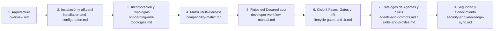

# aigile-forge-framework — Portal de Documentación

> **Idioma / Language:** Español | [English Documentation Portal (`docs/en/index.md`)](../en/index.md) | **Inicio Rápido:** [`README.es.md`](../../README.es.md)

Bienvenido al portal oficial de manuales técnicos y guías operativas de **`aigile-forge-framework`**.

`aigile-forge-framework` es un marco abierto, declarativo y determinista de ingeniería de software asistida por IA. A partir de una única fuente de verdad versionada (`aff.yaml`, `AGENTS.md`, `agents/`, `skills/`, `profiles/`, `prompts/`, `templates/` y `mcp/`), el framework proyecta configuraciones nativas para **Claude Code**, **OpenCode**, **Google Antigravity**, **OpenAI Codex** y **GitHub Copilot**, adaptándose a cualquier equipo de desarrollo sin acoplamiento organizacional ni dependencia de proveedores específicos.

---

## 1. Mapa Completo de Manuales y Guías

Todos los documentos de `docs/es/` mantienen correspondencia 1:1 con su contraparte en inglés bajo `docs/en/`:

| Categoría | Manual en Español | Equivalente en Inglés | Propósito Principal |
|---|---|---|---|
| **Arquitectura** | [Arquitectura Universal y Proyección Determinista](architecture/overview.md) | [`docs/en/architecture/overview.md`](../en/architecture/overview.md) | Modelo de 3 capas, motor de proyección, modos `zero-mcp` vs `mcp`, exclusión `--zero-footprint` y criptografía SHA256. |
| **Instalación** | [Manual de Instalación y Configuración](guides/installation-and-configuration.md) | [`docs/en/guides/installation-and-configuration.md`](../en/guides/installation-and-configuration.md) | Prerrequisitos por sistema operativo, instalación en proyectos nuevos o existentes, referencia completa de `aff.yaml` v2.0 y diagnóstico. |
| **Incorporación** | [Incorporación de Equipos y Topologías](guides/onboarding-and-topologies.md) | [`docs/en/guides/onboarding-and-topologies.md`](../en/guides/onboarding-and-topologies.md) | Uso de `./aigile init`, entrevista `/init-team` de 6 dimensiones, elección de topología (`single-repo`, `worktrees`, `multi-root`), tickets y PERT. |
| **Operación Diaria** | [Manual Operativo del Desarrollador](guides/developer-workflow-manual.md) | [`docs/en/guides/developer-workflow-manual.md`](../en/guides/developer-workflow-manual.md) | Invocación práctica en los 5 harnesses y 4 flujos paso a paso (funcionalidad de punta a punta, interrupción urgente, hotfix `H` y paridad `L`). |
| **Gobierno y Calidad** | [Ciclo de Vida de 8 Fases, Compuertas y 4R](guides/lifecycle-gates-and-4r.md) | [`docs/en/guides/lifecycle-gates-and-4r.md`](../en/guides/lifecycle-gates-and-4r.md) | Fases 0–7, dimensionamiento proporcional `S/M/L/H`, listas de control `G1`–`G4`, auditoría 4R de dos pasadas y recibos RDD. |
| **Harnesses** | [Matriz de Compatibilidad Multi-Harness](harnesses/compatibility-matrix.md) | [`docs/en/harnesses/compatibility-matrix.md`](../en/harnesses/compatibility-matrix.md) | Detalle técnico de `scripts/aff-harness.sh`, artefactos proyectados, transformación de frontmatter, `--symlink` vs `--copy` y política `zero-mcp`. |
| **Catálogo** | [Catálogo de Agentes y Slash Prompts](catalog/agents-and-prompts.md) | [`docs/en/catalog/agents-and-prompts.md`](../en/catalog/agents-and-prompts.md) | Referencia de los 10 agentes de rol, los 7 sub-roles de `delivery` y los 9 prompts interactivos con entradas, salidas y handoffs. |
| **Catálogo** | [Catálogo de Habilidades y Perfiles Tecnológicos](catalog/skills-and-profiles.md) | [`docs/en/catalog/skills-and-profiles.md`](../en/catalog/skills-and-profiles.md) | Las 14 `skills` troncales, las 5 `skills` opcionales `cortex-ai-*`, los 7 perfiles de stack (`applyTo`) y creación de extensiones propias. |
| **Seguridad y Datos** | [Seguridad, Datos y Sincronización de Conocimiento](governance/security-and-knowledge-sync.md) | [`docs/en/governance/security-and-knowledge-sync.md`](../en/governance/security-and-knowledge-sync.md) | Escáner `aff-secret-scan.sh`, protección PII/PHI/PCI, reglas de índices y caché con TTL, y sincronización `local`, `folder-sync` y `cortex-ai`. |

---

## 2. Rutas de Lectura por Rol en el Equipo

Para adoptar `aigile-forge-framework` con el menor tiempo de rampa posible, siga el itinerario correspondiente a su responsabilidad dentro del equipo de desarrollo:

### Líder Técnico / Arquitecto de Software
1. **[Arquitectura Universal](architecture/overview.md)** — Comprenda la separación entre fuente canónica, proyecciones efímeras y estado de ejecución.
2. **[Manual de Instalación y Configuración](guides/installation-and-configuration.md)** — Defina `aff.yaml`, los perfiles habilitados en `profiles.enabled` y el modo `zero-mcp` o `mcp`.
3. **[Incorporación de Equipos y Topologías](guides/onboarding-and-topologies.md)** — Seleccione entre `single-repo`, `worktrees` o `multi-root` y ejecute `/init-team` para poblar `knowledge/`.
4. **[Ciclo de Vida de 8 Fases, Compuertas y 4R](guides/lifecycle-gates-and-4r.md)** — Calibre las compuertas `G1`–`G4`, `dual_po_approval` y `multi_channel_parity`.

### Desarrollador de Software (Backend, Frontend, Móvil, Full-Stack)
1. **[Manual Operativo del Desarrollador](guides/developer-workflow-manual.md)** — Aprenda cómo invocar agentes y comandos en su CLI o IDE preferido y practique los 4 flujos del día a día.
2. **[Catálogo de Agentes y Slash Prompts](catalog/agents-and-prompts.md)** — Consulte qué prompt (`/aff-intake`, `/work-units`, `/review-4r`) utilizar en cada etapa de un ticket.
3. **[Catálogo de Habilidades y Perfiles Tecnológicos](catalog/skills-and-profiles.md)** — Revise los estándares exigidos para su lenguaje y base de datos antes de escribir código.
4. **[Matriz de Compatibilidad Multi-Harness](harnesses/compatibility-matrix.md)** — Configure su entorno local con `./aigile harness sync` sin editar manualmente archivos generados.

### Ingeniería de Calidad (QA) / Revisor de Código
1. **[Ciclo de Vida de 8 Fases, Compuertas y 4R](guides/lifecycle-gates-and-4r.md)** — Domine la auditoría determinista 4R de dos pasadas (**Risk, Requirements, Regression, Resilience**) y la verificación de firmas SHA256.
2. **[Manual Operativo del Desarrollador](guides/developer-workflow-manual.md)** — Revise cómo ejecutar `/review-4r`, `/review-refuter`, `/parity-check` y `./aigile receipt verify`.
3. **[Catálogo de Agentes y Slash Prompts](catalog/agents-and-prompts.md)** — Inspeccione las responsabilidades de los agentes `qa` y `reviewer`.

### Ingeniería de Seguridad / Plataforma / DevOps
1. **[Seguridad, Datos y Sincronización de Conocimiento](governance/security-and-knowledge-sync.md)** — Audite las reglas de `aff-secret-scan.sh`, el bloqueo de datos sensibles y las salvaguardas de replicación documental.
2. **[Manual de Instalación y Configuración](guides/installation-and-configuration.md)** — Despliegue el hook `pre-commit` (`./aigile scan --install-hook`), valide entornos restringidos (`zero-mcp`) y gestione variables de entorno MCP.
3. **[Matriz de Compatibilidad Multi-Harness](harnesses/compatibility-matrix.md)** — Verifique que `./aigile harness check` garantice ausencia total de descriptores MCP cuando `harnesses.mode: "zero-mcp"`.

---

## 3. Orden de Lectura Recomendado de Inicio a Fin

Si desea recorrer la suite documental completa en secuencia lógica:



---

## 4. Principios Rectores de `aigile-forge-framework`

1. **Fuente Canónica Única, Cinco Harnesses:** Edite las reglas, agentes, habilidades y perfiles tecnológicos en un solo árbol canónico; regenere cualquier integración mediante `./aigile harness sync`.
2. **Neutralidad Organizacional Absoluta:** El núcleo del framework carece de nombres de empresas, estructuras rígidas o dependencias hacia herramientas propietarias. Todo contexto del proyecto vive declarativamente en `aff.yaml` y `knowledge/`.
3. **Ceremonia Proporcional al Riesgo (`S / M / L / H`):** Las correcciones puntuales (`S`) fluyen con agilidad mediante TDD y revisión 4R; las iniciativas multirrepositorio (`L`) y los incidentes críticos (`H`) activan contratos explícitos, paridad multicanal y análisis de causa raíz.
4. **Evidencia Criptográfica sobre Afirmaciones Conversacionales:** Las transiciones de compuerta se respaldan con recibos JSON firmados con SHA256 (`./aigile receipt`) y análisis preventivo de secretos (`./aigile scan`).
5. **Continuidad en Frío sin `git stash`:** El aislamiento mediante árboles de trabajo (`./aigile worktree`) y bitácoras estructuradas (`./aigile session`) permite pausar y retomar cualquier ticket desde otro harness en segundos sin perder contexto.

---

## 5. Verificación Rápida del Espacio de Trabajo

En cualquier momento, compruebe que la instalación local, los esquemas YAML/JSON y las proyecciones estén íntegros ejecutando:

```bash
./aigile doctor
./aigile harness check
./aigile harness status
```

Consulte la [Licencia MIT (`LICENSE`)](../../LICENSE) en la raíz del proyecto para revisar las condiciones abiertas de uso y distribución.
